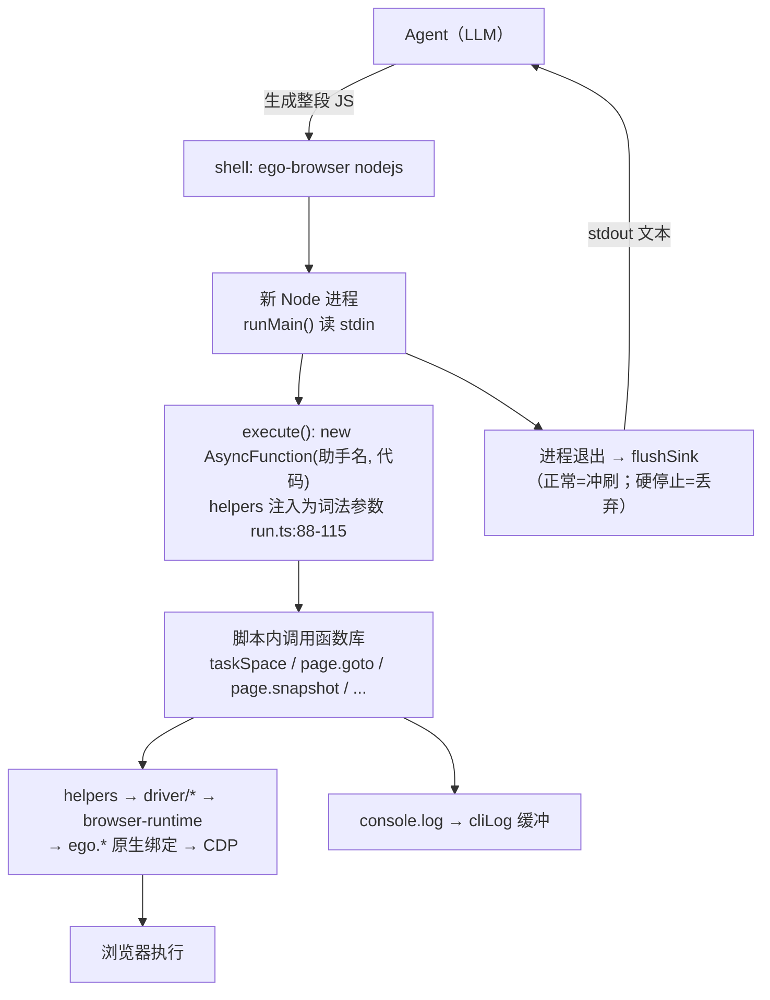

# ego-browser 的 Agent 调用模型：代码执行 vs 工具调用

> 回答"agent 到底怎么用工具操控浏览器"。与 `out/架构分析.md`（代码结构视角）互补，本文是**调用模型视角**。
> 对照项目：chrome-devtools-mcp（fork 版实测 55 个离散工具）。
> ego 侧引用相对 `package/ego-browser/`。

## 1. 核心命题：ego-browser 不是工具服务器，是代码执行线束

chrome-devtools-mcp 与 ego-browser 解决同一个问题（把浏览器能力交给 agent），但选择了**两个物种**：

| | chrome-devtools-mcp | ego-browser |
|---|---|---|
| 物种 | MCP 工具服务器 | **代码执行 harness**（shell 命令 + JS 线束） |
| 对 agent 暴露的入口 | 55 个离散工具（click / fill / navigate_page / take_snapshot…） | **1 个命令**：`ego-browser nodejs`（外加 `skill` / `upgrade` 等元命令） |
| 一次"调用"的粒度 | 1 工具 = 1 浏览器动作 | **1 命令 = 1 段完整 JS 程序**（内含 N 个动作、循环、条件） |
| "工具"在哪 | MCP 协议注册的 tool schema（常驻 agent 上下文） | 脚本内可直接调用的**函数库**（helpers，注入为词法参数） |
| 结果回传 | 每个工具调用一个 result | 程序的 console 输出（**事务缓冲**，退出时一次性 flush） |
| 状态住在哪 | MCP server 进程（长驻，puppeteer 会话） | **浏览器侧**（任务空间/ledger/引用跨轮持久）；agent 进程每轮都是新的 |

README 对此毫不掩饰（"Code-based, not CLI-based"）：*The agent gets to do what it does best: write code, composing a multi-step task into a single output instead of getting stuck in a "call two commands, look at the result, call two more commands" loop.*——即把"组合 N 步"从**运行时循环**变成**一次生成**。

## 2. 一次完整调用的解剖（agent 视角）

以本会话抖音任务的第一轮为例：

```bash
# ① agent 产出一段 JS，通过 heredoc 喂给唯一的入口命令
ego-browser nodejs <<'EOF'
const task = await taskSpace("douyin-draft-upload");   // ← "工具调用"=普通函数调用
console.log("spaceId=" + task.spaceId);                //   （helpers 已注入，无需 import）
const page = task.page("p1");
await page.goto("https://creator.douyin.com/...");
console.log(await page.snapshot());
EOF
```

端到端链路：



三个关键设计：

1. **helpers 是词法参数不是 import**（run.ts:96-107）：`new AsyncFunction(...names, code)`——脚本作者零负担拿到全部 API；`console` 也是词法参数，遮蔽而不污染 Node 全局
2. **输出通道窄且事务化**：agent 能看到的只有 stdout 文本（cliLog 缓冲、退出冲刷、硬停止全量丢弃）——上下文经济学：**一轮 = 一份输出**，而不是 N 个工具 result
3. **跨轮状态在浏览器侧**：进程每轮都是新的，但 spaceId、Page 标签、@N 引用、控制权状态由浏览器/ledger 持久——所以指南要求"打印 spaceId，下一轮用它恢复"

## 3. "工具面"的定义、发现与教学（三份清单，全部惰性）

| 清单 | 位置 | 作用 |
|---|---|---|
| v2 API 事实来源 | `src/public-api-schema.ts`（`PUBLIC_API_SCHEMA`） | 运行时选项校验 + `help()` 生成 + 文档共用 |
| v1 冻结面 | `src/helpers.ts` | 旧脚本兼容 |
| 运行时自描述 | `help()` / `help("page.click")`（help-runtime.ts，acorn 解析构建产物 JSDoc） | **按需拉取**单个 API 的签名与冷门选项 |
| 教学文档 | `skill-body/SKILL.md`（551 行），由 `ego-browser skill` 打印 | 版本化（v2.1.0）+ 截断标记，25k 字符上限 |

与 MCP 的结构性差异：MCP 的 55 个 tool schema **常驻** agent 上下文（协议握手时全量下发）；ego 的 API 描述**按需拉取**（help() 只在 agent 主动问时付费），教学文档只在任务开始时注入一次。对强 agent 来说这是明显的上下文节省——代价是新 agent 没有"工具列表"可看，依赖 skill 指引与 help() 的主动使用。

## 4. 工具面映射：55 个 MCP 工具 ↔ ego 函数库

| chrome-devtools-mcp（55 工具） | ego-browser 等价物 | 备注 |
|---|---|---|
| `navigate_page` / `new_page` / `close_page` / `list_pages` / `select_page` | `page.goto()` / `task.newPage()` / `page.close()` / `task.pages()`·`task.tabs()` / `task.adopt()` | ego 的页面管理带**持久标签**（p1/p2）与所有权模型 |
| `click` / `click_at` / `hover` / `drag` / `type_text` / `press_key` / `fill` / `fill_form` | `page.click()` / `page.mouse.click(x,y,{label})` / `page.hover()` / `page.dragAndDrop()` / `page.keyboard.*` / `page.fill()`（fill_form 用脚本循环） | ego 的指针动作带**可见光标与动作 label** |
| `take_snapshot` / `take_screenshot` | `page.snapshot()` / `page.screenshot()` | 快照即快照管线产物（另见 snapshot-pipeline 文档） |
| `handle_dialog` | `page.acceptDialog()` / `dismissDialog()` | JS 对话框独立于控制权通道 |
| `upload_file` | `page.setInputFiles()` / `waitForFileChooser` | |
| `evaluate_script` | `page.evaluate(fn, arg)` / `page.cdp()` / `task.cdp()` | |
| `wait_for` | `waitForSelector` / `waitForURL` / `waitForFunction` / `waitForLoadState` / `waitForEvent` / `waitForTimeout` | |
| `resize_page` / `emulate` | 无专用 API（`page.cdp()` 逃生舱） | |
| `list_network_requests` / `get_network_request` / `get_console_message` | 无专用 API（`page.events()` 缓冲 + `page.cdp()` 手开 Network/Runtime domain） | ego 面更窄，但 cdp() 是全量逃生舱 |
| `performance_*` / `lighthouse_audit` / `take_heapsnapshot` 家族（约 20 个工具） | 无对应（cdp() 理论可达） | chrome-devtools-mcp 的**调试/性能侧重**是工具面差异最大的地方 |
| `screencast_*` / `install_extension` 等 | 无对应 | |
| ——（MCP 无对应） | `taskSpace` / `claimTaskSpace` / `takeOverTaskSpace` / `handOff` / `waitForControl` / `finish` | **空间所有权与控制权转移**是 ego 独有维度（见 user-control-transfer 文档） |
| ——（MCP 无对应） | `runSiteTool` / `runSiteBrowserTool` / `learnContext` | 站点经验包（learnings） |

结论：chrome-devtools-mcp 的工具面**宽而调试向**（heap/performance/lighthouse 占 20+）；ego 的面**窄而操作向**，但多出"空间/控制权/经验包"三个结构性维度，且任何缺口都能用 `cdp()` 逃生舱在脚本内补齐——这正是代码执行模型的优势：**没有的工具可以当场写**。

## 5. 同物种对照：browser-harness（browser-use 官方）

chrome-devtools-mcp 是**另一个物种**（工具调用）；browser-harness（~1k 行 4 文件的 Python harness，连用户真实 Chrome）是**同物种的另一个极端**。调用形态几乎同构：`browser-harness <<'PY' ... PY`（heredoc、助手预导入、一命令一程序、Skill 交付、`cdp()` 逃生舱、daemon 常驻持状态、domain-skills≈learnings）。ego 的 README benchmark 即以它为对照组。

四个维度的哲学对立：

| 维度 | browser-harness | ego-browser |
|---|---|---|
| harness 本体 | **thin & editable**：核心卖点是 `agent_helpers.py` 让 agent 执行中改写 harness 自己（self-improving） | **frozen & full-service**：扩展只走 learnings 与脚本内 `cdp()`，设计上不允许改 harness |
| 观察/交互默认通道 | **screenshot-first + 坐标点击**：明令"Suppress the Playwright-habit reflex of 'locate first, then click'"；命中测试在 compositor 层，天然穿 iframe/shadow DOM | **snapshot-first + 语义引用**：a11y 树 + @N + loc=，文本进上下文 |
| 浏览器归属 | 借**用户正在用的真实 Chrome**（一条 websocket，"nothing between"）；需自律不毁用户现场（先 new_tab 再操作） | 自有浏览器 + Spaces 隔离 + 控制权转移 |
| 并行方案 | 云浏览器（BU_NAME 各起隔离实例） | 同一浏览器内多 Space |
| 规模 | ~1k 行 / 4 文件 / 17 个 interaction-skills 文档 | 21k 行 / 44 文件 / 18k 行测试 / schema 驱动 |
| 站点经验治理 | agent 自写 + 社区 PR，默认关闭（BH_DOMAIN_SKILLS=1） | curated + validate-site-skills 校验器，默认捆绑 |

**互为对方的解药**（实测交叉验证：抖音封面发布任务在两项目上都跑过）：

- 抖音封面上传类 UI（canvas 编辑器、无语义 div 按钮）是 ego 快照优先的**盲区**（实测烧了十几轮）；browser-harness 的"截图看一眼→坐标点"对此是降维打击
- browser-harness 每次观测吞一张截图的 token；ego 一份文本快照远为便宜——ego benchmark 的 token/速度优势部分建立在此对比上

三项目光谱：**chrome-devtools-mcp（工具调用，宽调试面）↔ ego-browser（代码执行，受控语义共享浏览器）↔ browser-harness（代码执行，自由视觉薄 harness）**。

## 6. 两种模型的经济学对比

| 维度 | 工具调用（MCP） | 代码执行（ego） |
|---|---|---|
| 往返次数 | 每动作一次 LLM 调用 | 每轮（N 动作）一次 |
| 上下文累积 | N 个 tool result 逐条入上下文 | 1 份程序输出（可自由裁剪打印什么） |
| 中间观测 | 每步都看得见（可中途纠正） | 默认只见结果；要观测得自己 print 或分轮 |
| 表达力 | 参数化（受 schema 限制） | 图灵完备（循环/条件/局部状态/组合逻辑） |
| 失败语义 | 单步失败单步重试 | 整轮语义（硬停止连缓冲输出都丢弃） |
| 权限确认粒度 | 每工具调用可确认 | 轮级（+ ego 的控制权转移机制兜底人机争用） |
| 对 agent 能力的假设 | 弱 agent 也能用 | 假设 agent 会写代码（强模型红利） |

README 的 benchmark 宣称（Real-World Bench 31 任务：比其他工具快 47-63%、更少 tool calls、更低单任务成本）本质上是这个经济学差异的量化。但注意代价侧：**中间可观测性弱**——调试复杂页面时（如本次抖音封面上传）看不到每步状态，只能靠脚本内打印与分轮试错；MCP 模型在"逐步确认型"工作流（人工监督下的自动化）里反而更合适。

## 7. 给框架设计者的启示

1. **两种模型不互斥**：MCP 面适合产品化/弱 agent/需逐步审批的场景；代码面适合强 agent/批处理/追求吞吐的场景。一个浏览器 agent 框架可以同时提供"离散工具"与"代码执行"两个门面
2. ego 值得抄的三个"上下文经济学"技巧：**API 描述按需拉取**（help() 惰性发现，对比 MCP schema 常驻）、**教学文档版本化按需打印**（skill 命令 + 截断标记）、**输出事务化**（一轮一份输出，硬停止零泄漏）
3. 状态住浏览器侧而非 harness 进程——agent 进程可以随意死，人机协作连续性不断（这也是控制权转移机制的前提，两文档互为表里）
4. `cdp()` 逃生舱是工具面的安全网：宁可 API 面窄 + 全量协议可达，也不要 API 面宽但封死底层

## 8. 相关文档

- [snapshot-pipeline.zh-CN.md](snapshot-pipeline.zh-CN.md)：快照（本模型的核心"观测工具"）的完整管线
- [user-control-transfer.zh-CN.md](user-control-transfer.zh-CN.md)：控制权转移（本模型的人机争用解法）
- `out/架构分析.md`：代码结构视角的总览（§5 已补本文链接）
- `skill-body/SKILL.md`：agent 侧官方使用规范（`ego-browser skill` 可打印）
