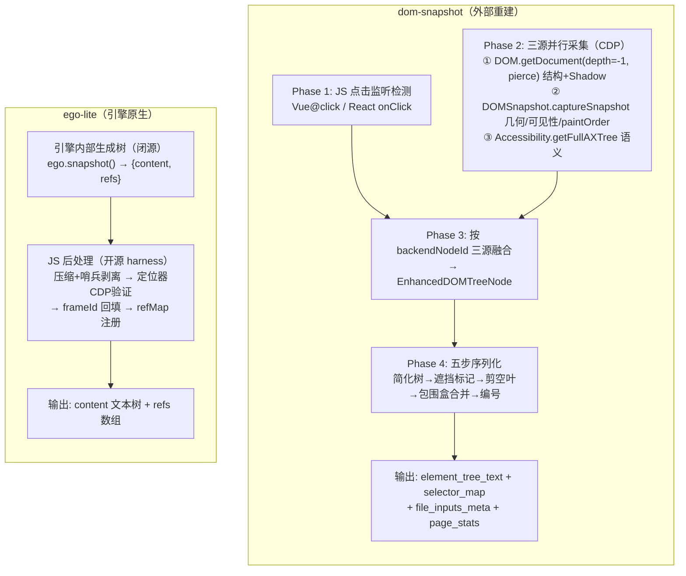

# 快照引擎对比：dom-snapshot（外部三源融合） vs ego-lite（引擎原生）

> 整理自 2026-10-25 ~ 10-27 对 ego-lite 0.6.1.11 实机调试 + `dom-snapshot/ARCHITECTURE.md` 源文档的交叉分析。
> 配套阅读：[snapshot-pipeline.zh-CN.md](snapshot-pipeline.zh-CN.md)（ego-lite 全链路管线文档）。
> ego-lite 侧引用相对 `package/ego-browser/`；dom-snapshot 侧引用相对该仓库根目录。

## 1. 对比对象与结论先行

| | dom-snapshot | ego-lite 快照层 |
|---|---|---|
| 定位 | 独立 Python 库：把浏览器状态变成 LLM 可消费的文本树 + 寻址表 | ego 浏览器 harness 的快照子系统：同一定位 |
| 目标浏览器 | 任意 Chromium（经 CDP 外部接入，`CDPLikeClient` 鸭子类型解耦） | ego lite 浏览器（闭源引擎，原生绑定） |
| **本质差异** | **整条管线在外部**：三源采集 → 融合 → 序列化，全部自己实现 | **树生成锁在引擎内**（闭源 `ego.snapshot()`），JS 层只做去噪、验证、注册 |

一句话：**dom-snapshot ≈ ego-lite 的"引擎树生成（外部重建版）+ serializer"——两个项目加起来才是 dom-snapshot 一个库干完的事；而 ego 把难的那半锁进了闭源引擎，dom-snapshot 把全部握在自己手里。** 两边不是"同一件事换个浏览器"，而是**管线住在哪一层**的架构分野。

## 2. 架构总览

dom-snapshot 的三源融合，本质是**从外部"逼近"引擎内部天然拥有的统一视图**：DOM 树缺语义、AX 树缺几何与隐藏结构、captureSnapshot 缺语义——没有任何单一 CDP 域是完备的，融合是外部方案的必经之路。ego 引擎内部本来就是同一时刻的同一棵树，不需要融合，但外部也拿不到生成权。

## 3. 管线逐层对应

| dom-snapshot | ego-lite 对应物 | 备注 |
|---|---|---|
| collector 三源采集 + backendNodeId 交叉融合 | **无对应——在引擎内部（闭源）** | 两边架构的分水岭 |
| Phase 1 `_detect_js_click_listeners()` | 无 | 无 role 的 div 可交互性，AXTree 不认 |
| serializer Step 1-3（简化/剪枝） | 引擎侧规格 A.1 + JS `compactSnapshotContent`（snapshot-result.ts:51-115） | ego 把压缩**拆两层**做：引擎先简化（规格要求），JS 兜底；dom-snapshot 全在自己手里 |
| Step 2 `PaintOrderRemover`（paintOrder 几何差集标记遮挡） | 无 | ego 快照不含遮挡信息，点击时才报 "not actionable" |
| Step 4 包围盒传播合并（`<a>`/`<button>`） | 无（引擎侧自行决定粒度） | |
| Step 5 可交互编号 + `selector_map` | `refs` + `browserSnapshotRefsToRefMap`（browser-runtime.ts:1563-1581） | 同一职责：文本树 ↔ 寻址表。dom-snapshot 的 index **直接用 backend_node_id**；ego 多一层快照内唯一的 `refId` 再映射到 backendNodeId |
| `_collect_file_inputs()` → `file_inputs_meta` + `[File Inputs]` 段 | **无** | 隐藏的 `input[type=file]` 在 dom-snapshot 有专门数据源；在 ego 因 AXTree 契约（hidden 不入树）整体消失 |
| `prev_map` diff → `*` 新元素前缀 | 无（文本树层面） | ego 跨轮持久靠 page-ledger 的 ref 机制，但 LLM 在文本里看不到"这是新元素" |
| `\|scroll element\|` 滚动标记 | 无 | |
| `compound_components=(...)` 复合组件 | 引擎侧天然给出（如可见 file input = textbox+button，HTML-AAM 映射） | 殊途同归到同一套无障碍映射 |
| 降级阶梯 FULL→MINIMAL→PARTIAL→FAILED | "非两空格缩进原样放行"守卫（snapshot-result.ts:63-64）+ locator safeguard | dom-snapshot 的降级更系统；ego 的兜底是防御性兼容 |
| `EMPTY_DOM_STATE` 采集失败兜底 | 后台标签返回空树 `"root"`（实测） | ego 的表现更接近"静默空结果"而非显式降级 |

## 4. LLM 可见信息对照

| 信息 | dom-snapshot | ego-lite |
|---|---|---|
| 语义角色/名称/文本 | ✅（源3 AX） | ✅（引擎 AXTree） |
| 元素标签与关键属性（id/class/accept/aria-*） | ✅（源1 DOM，`DEFAULT_INCLUDE_ATTRIBUTES` 过滤） | ❌（role-first 文本树不带属性；仅个别 `loc=css:...` 提示） |
| 隐藏但可操作节点（file input 等） | ✅ `file_inputs_meta` 专项 | ❌ |
| 遮挡状态 | ✅ Step 2 标记 | ❌ |
| 无 role 的可交互 div | ✅ 监听器检测 + 编号 | ❌（树上是裸 `container`/`text`，无 ref） |
| 几何/滚动上下文 | ✅ 源2 + scroll 标记 | ❌（坐标只有截图通道） |
| Shadow DOM 边界 | ✅ Open/Closed Shadow 标记 | ✅（引擎扁平化输出；CSS 搜索嵌套开放影子根） |
| iframe/OOPIF 内容 | ✅ `attach_to_iframe_target` 逐帧接入 | ✅ 引擎内扁平化（"最强快照"卖点），refs 的帧归属另有 A.3 规格约束 |
| 跨轮"新元素"标记 | ✅ `*` 前缀 | ❌（ref 持久化有，文本不可见） |
| 稳定定位器 | index=backendNodeId 本身即稳定键 | ✅ `loc=css:...`（经 CDP 真伪验证，无效即删） |
| 定位不稳定信号 | —（index 天然稳定） | 引擎产出 `loc=unstable` 哨兵，**JS 剥除后 LLM 不可见**（0.6.1.11 实测违反规格 A.4 仍在吐） |

## 5. 实战回放：抖音封面案例（2026-10-25）

任务：在 `creator.douyin.com` 上传页设置封面。现场特征：Semi Design 组件库把原生 `input[type=file]` 藏在 `semi-upload-hidden-input`（display:none）后，可见入口是无 role 的 div，裁剪器是 canvas。

**ego-lite 路径（实际发生）**：快照里"上传封面"是无 ref 的裸文本 → 点击页签失败（"matched 1 elements, but not actionable"，快照解释不了原因）→ 用 evaluate 逃生舱挖出 6 个 file input 按序号猜错对象（选到"生成参考图"那对，触发格式报错）→ 最终靠 accept 属性定位成功，耗 ~6 轮。

**dom-snapshot 路径（推演）**：`_collect_file_inputs()` 直接产出 `[File Inputs]` 段（含 backend_node_id / accept / visible / upload_ancestor），`ClickableElementDetector` 给可见 div 发交互编号 → 一轮内 `setInputFiles` 完成。遮挡标记还能提前解释遮罩下按钮为何不可点。

这个案例是两种架构差异的浓缩：**引擎原生路线继承了页面的无障碍缺陷（组件库藏原生控件），外部重建路线拥有对冲这种缺陷的改写权。**

## 6. 互相借鉴的方向

**ego-lite 可借鉴 dom-snapshot（harness 层可行，不动引擎）：**

1. **P0：file input 注入**——`page.cdp()` 发得出 CDP，可在 JS 层实现 mini 版 `_collect_file_inputs()`，把隐藏 file input 合成进 refs/content（仿照 refs 结构绑定 backendNodeId，挂进 refMap 即可寻址）
2. **P1：可交互性补判**——`DOMDebugger.getEventListeners` 或注入式监听器检测，给无 role 但可交互的节点补 ref
3. **P2：注记段**——scrollable 容器、遮挡关系（`DOMSnapshot.captureSnapshot` 的 paintOrder）、`*` 新元素 diff 标记，都可以在 JS 层以尾部注记形式附加
4. 更激进的路线：在 harness 层用三源（DOM/DOMSnapshot/Accessibility）整套重建增强管线，与引擎树并行输出
5. 保留而非剥除 `loc=unstable` 信号（信息现成，改动极小）

**dom-snapshot 较难白嫖 ego 的两点：**

1. 深层 iframe/OOPIF 扁平化在引擎内做，一次快照全覆盖；外部需逐帧 attach（dom-snapshot 已有 `build_frame_target_map`，但成本与复杂度更高）
2. 无三源时序/一致性问题——引擎内是同一时刻的同一棵树

**给 ego 上游提需求的现成素材**：本对比的第 4 节信息对照表 + 第 5 节案例，以及 `docs/native-snapshot-ref-requirement.md` 规格与 0.6.1.11 实装的三处偏差（`loc=unstable` 泄漏、非 Cf 隐形字符文本漏网、content/refs 生成通道分裂）。

## 7. 参考文件索引

**ego-lite（`package/ego-browser/`）**

| 环节 | 位置 |
|---|---|
| 快照入口 / 选项 | `src/driver/observe.ts:23-78` |
| 压缩 + 哨兵剥离 + 空文本判空 | `src/snapshot-result.ts:51-115, 175-187` |
| 定位器验证 / frameId 回填 | `src/snapshot-result.ts:202-336` |
| refs → refMap 注册 | `src/browser-runtime.ts:1563-1581` |
| Page scope 默认 / header 行 | `src/page-model.ts:1718, 3022` |
| 引擎侧规格契约 | `docs/native-snapshot-ref-requirement.md`（中文版：`docs/native-snapshot-ref-requirement.zh-CN.md`） |
| 全链路管线文档 | `docs/snapshot-pipeline.zh-CN.md` |

**dom-snapshot**

| 环节 | 位置 |
|---|---|
| 三源采集 + 融合 + 入口 `build_dom_state` | `src/dom_snapshot/collector.py`（原 TreeWalker `dom.py`） |
| 五步序列化 / 主文本格式 | `src/dom_snapshot/serializer.py` |
| 遮挡算法 | `src/dom_snapshot/paint_order.py` |
| 可交互检测（Vue@click / React onClick） | `src/dom_snapshot/interactive.py` |
| 数据模型 / CDP 协议解耦 | `src/dom_snapshot/models.py`、`src/dom_snapshot/_protocol.py` |
| 架构文档（本文对照的原始材料） | `ARCHITECTURE.md` |
| 实测 dump 样本（element_tree_text 格式实证） | `TreeChrome/examples/_model_page_view_dump.txt` |
