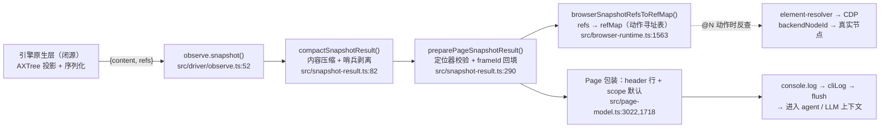

# ego-lite 快照管线：从引擎原生树到 LLM 上下文

> 整理自源码（fork@main d392204）+ 2026-10-25/26 对 0.6.1.11 实机的调试实测。
> 仓库中原本没有覆盖全链路的文档；最接近的官方材料是 `docs/native-snapshot-ref-requirement.md`（引擎侧规格契约），其全文翻译见附录 A。
> 所有 `文件:行号` 均相对 `package/ego-browser/`。

## 0. 总览



一句话：**引擎产出语义（角色/文本/引用标记/定位器），JS 层只做去噪、验证、注册和包装，不添加任何语义。**

## 1. 阶段 0：引擎原生层（闭源）

ego lite 浏览器在引擎内定制了无障碍树的采集与序列化，harness 通过原生绑定调用：

```ts
// src/driver/observe.ts:52-59
const result = await invokeEgo("snapshot", () => browserEgo().snapshot(options));
```

**输入**：页面 DOM/AX 状态。**输出**：`{ content: string, refs: SnapshotRef[] }`

- `content`：两空格缩进的文本树，`root` 开头；节点行为 `角色 [ref=N, loc=...]` + 文本子节点 `text "..."`
- `refs`：机器可读的寻址元数据，每条 `{ refId, backendNodeId, frameId?, frameProvenance?, role, name, loc? }`

引擎侧必须遵守的规则（压缩文本、iframe 引用、稳定定位器）定义在 `docs/native-snapshot-ref-requirement.md`，即附录 A 的原文。

**关键契约**：快照是无障碍树（AXTree）的投影。`display:none` / `visibility:hidden` 的节点**不进入这棵树**——不是"丢弃"，是 AXTree 的定义使然（实测验证：隐藏的 `input[type=file]` 无 ref 无节点；可见的 file input 以 `textbox + button` 复合形式出现，符合 HTML-AAM 映射）。

**快照的三个选项**（透传给引擎）：

| 选项 | 取值 | 说明 |
|---|---|---|
| `scope` | `only_within_viewport` / `full_page` / `subtree` | 捕获范围；Page API 默认视口（`page-model.ts:1718`），裸助手 `snapshotText()` 默认全页（`observe.ts:72`） |
| `includeActionMarks` | bool，默认 true | 是否在树里输出 `[ref=N]` 标记 |
| `includeStableLocator` | bool，默认 true | 是否输出 `loc=...` 稳定定位器 |
| `root` | refId | 配合 `subtree` 限定子树 |

## 2. 阶段 1：内容压缩（`compactSnapshotResult`，snapshot-result.ts:82-115, 93-100, 175-187）

对 `content` 文本执行以下变换（`compactSnapshotContent`）：

1. **格式守卫**：只认"两空格缩进"的树编码；遇到其他形状（旧版本运行时）**原样放行**，不做有损改写（snapshot-result.ts:63-64）
2. **删空行**：过滤纯空白行（:56）
3. **哨兵剥离**：节点行的元数据 `[ref=N, loc=unstable]` → `[ref=N]`（`omitUnusableLocatorStatus` :102-115）。引号感知：`findSnapshotMetadataStart`（:147-173）保证 accessible name 里出现的 `"[ref="` 字样不会被误当元数据改写
4. **容器折叠**（`compactSnapshotNode` :93-100）：
   - 无名 `container` 且无剩余子节点 → 删除
   - 无名 `container` 且只有一个孩子 → 用孩子替换（链式折叠）
   - 无名 `container` 多孩子 → 保留（保持分组）
   - 有名或带 ref 的容器、语义节点（button/textbox/image/svg_root/canvas/iframe/list item/表格单元格）→ 永不折叠
5. **空文本节点删除**（`isEmptySnapshotText` :175-187）：`text "..."` 的值去掉空白与 `\p{Cf}`（格式字符，含零宽空格 U+200B）后为空 → 整节点删除

对 `refs` 数组：`loc === "unstable" || loc === "ambiguous"` 的条目直接 `delete ref.loc`（:87-89）。

**实测收益**（抖音创作者中心页）：452 行→392 行、13,739 字符→11,172 字符（-19%）、`container` 179→119，`[ref=N]` 数量不变（41）。

## 3. 阶段 2：Page 路径增强（`preparePageSnapshotResult`，snapshot-result.ts:290-336）

Page API 的快照在压缩之后、返回之前多做三件事：

1. **定位器真伪验证**：把每个非哨兵 `loc` 候选通过 CDP 在真实 DOM 上解析（`validateLocatorBackendNodes`，element-resolver.ts:429），要求**唯一解析到产生该 ref 的 backendNodeId**。验证失败的定位器被删除——**ref 保留，loc 丢弃**（`sanitizeSnapshotLocators` :220-250），同时把 content 里对应行的 loc 摘掉（`omitSnapshotLocators` :252-287）
2. **frameId 回填**：iframe/OOPIF 内节点的 refs 若缺 `frameId`，从帧的 AX 树反推回填（`backfillSnapshotFrameIds`；规格文档 L69-72 描述了这个兜底关系）
3. **frameProvenance 标注**：每条 ref 标上 `page` / `frame` / `unknown`（:320-334），供后续动作路由判断该节点属于哪个渲染进程

另有 `rewriteSnapshotRefIds`（:129-145）：在 ref 合并/刷新场景下批量改写 content 里的 ref 编号，同样引号感知。

## 4. 阶段 3：refs 注册进寻址表（`browserSnapshotRefsToRefMap`，browser-runtime.ts:1563-1581）

```ts
refMap.clear();                          // 每次快照整体替换
refMap.addWithFrame(String(ref.refId ?? ref.backendNodeId),
                    ref.backendNodeId, ref.role, ref.name, undefined, ref.frameId);
```

- 缺 `backendNodeId` 的条目跳过
- 这张 refMap 就是 agent 写 `page.click("@14")` 时的反查表：`@14 → backendNodeId(+frameId) → CDP 解析到真实节点 → 派发输入`
- 注意这是**进程内、按快照替换**的映射（v1 风格）；跨轮持久化的 v2 引用（`@21` 绑定 frame/document/backend node 并由 ledger 合并/替换）走的是另一套 `page-ref-registry` + `page-ledger`（Page 快照后按 `pageRefDocumentId` 归档，见 page-model.ts:1737+）

## 5. 阶段 4：Page 包装与呈现

- **scope 默认视口**：`page-model.ts:1718`（`options.scope ?? "only_within_viewport"`），与裸助手默认全页不同；`public-api-schema.ts:243` 是对 agent 的官方说明
- **header 行**：`[p1 "标题" | space "空间名"(id): N managed, M untracked — 页面清单]`，由 `page-model.ts:3022` 拼接，让 LLM 不点 tabs() 也知道当前页与空间状态
- **进入上下文**：agent 脚本 `console.log(await page.snapshot())` → `cliLog` 缓冲 → 进程退出 flush（`output-sink`）→ 文本落到对话上下文

## 6. 各类信息的产地与去向速查

| 信息 | 引擎产出 | JS 后处理 | LLM 最终可见 |
|---|---|---|---|
| 角色 / accessible name / 文本 | ✅ | 原样 | ✅ |
| `[ref=N]` 标记 | ✅（includeActionMarks） | 原样 | ✅ |
| `loc=css:...` 稳定定位器 | ✅（includeStableLocator） | **CDP 真伪验证，无效即删** | ✅（仅幸存者） |
| `loc=unstable/ambiguous` 哨兵 | ✅（0.6.1.11 实测仍在吐，违反规格 A.3） | content 与 refs 双侧剥离 | ❌ |
| `backendNodeId` / `frameId` / `frameProvenance` | ✅ | frameId 回填、provenance 标注 | ❌（仅运行时使用） |
| 冗余无名容器包装 | ✅ | 折叠（-19% 体积） | ❌（被折叠） |
| 空白/零宽格式字符文本节点 | ✅（规格 A.1 要求省略，实测有泄漏） | 删除（`\s` + `\p{Cf}` 判空） | 基本不可见（非 Cf 隐形字符可漏网） |
| hidden 元素（如组件库藏的 `input[type=file]`） | ❌ 不进 AXTree | — | ❌（需 CDP 逃生舱自行挖掘） |
| header 行 / 页面清单 | — | Page 层拼接 | ✅ |

## 7. 已知实装偏差（实测清单，截至 0.6.1.11）

1. **`loc=unstable` 泄漏**：规格 A.3 明令禁止序列化，引擎仍在吐，JS safeguard 兜底剥离——意味着"引擎知道哪些节点定位不稳"这份信号在到达 LLM 前被丢弃
2. **隐形字符文本漏网**：判空规则覆盖 `\p{Cf}`，但部分非 Cf 隐形字符（某些 filler 类字符）仍会以 `text "…"` 空引号形式出现在压缩后输出
3. **content 与 refs 生成通道分裂**：data: URL 测试页上 refs 返回 3 条而 content 为空树——两者非同源生成
4. **快照路由跟"原生当前目标"走**：`browserEgo().snapshot()` 不带 target 参数（observe.ts:53-55），后台标签返回空树，需 `Page.bringToFront` 拨正

## 附录 A：`docs/native-snapshot-ref-requirement.md` 全文翻译

> 以下为引擎侧规格契约的中文翻译（原文为英文，行号对应原文件）。

### A.1 紧凑快照文本

序列化 `content` 前请先简化快照树：

- 省略空文本节点、纯空白（含 NBSP）节点、只含零宽格式字符的节点
- 省略已无剩余子节点的无名 `container`
- 用其仅剩的子节点替换无名 `container`
- 保留有多个子节点的无名 `container`（保持分组）
- 保留有名或带 ref 的容器，以及语义节点：`image`、`svg_root`、`canvas`、`iframe`、`root`、列表项、表格单元格

该变换必须保持剩余节点的顺序、refs、稳定定位器、URL 和 iframe 边界；对视口快照与全页快照同等适用。绝不因"不可交互"、因父容器被简化、或在清理定位器元数据时移除或改写非空页面文本。

验收：一个包含嵌套容器、空白文本、两个兄弟分组、一个 iframe、一张图片、一个 SVG、一个 canvas 和一个空表格单元格的夹具被捕获两次；第二次捕获的紧凑输出与第一次完全一致，兄弟分组保持可区分，且每个 ref 仍解析到原始节点。

### A.2 延后项：定向快照范围

未来的快照 API 应能按当前 ref 或选择器限定捕获某一子树（含 iframe / OOPIF 内部）。浏览器应在序列化快照**之前**应用范围；在 JS 里过滤全量快照不减少原生工作量与传输量。

被选根必须唯一解析、保留 Page 与帧的归属信息、产生的 refs 对正常 Page 动作保持有效。根缺失或歧义时应清晰报错。确切的公开 API 尚未决定，本要求不在当前实现排期内。

### A.3 iframe 内容的快照引用

`ego.snapshot()` 已包含普通 iframe 与 OOPIF 的文本，但这些帧内**可操作节点目前被排除在 refs 之外**——结果是"看得到内容却没有 @N 目标"。

请为快照打印的每个可操作帧节点返回 ref：

```js
{ refId: 901, backendNodeId: 21, frameId: "FRAME_OR_OOPIF_TARGET_ID",
  role: "button", name: "Run iframe action" }
```

- content 必须为该节点打印 `[ref=901]`
- `refId` 在一次快照内唯一（跨渲染进程亦然），即展示给 Agent 的编号
- `backendNodeId` 是该节点所在渲染进程的本地节点 id
- `frameId` 标识拥有该节点的帧；顶层文档可省略
- 捕获快照不得激活、聚焦或重载任何帧

验收：一页含同源 iframe 与跨源 OOPIF，不同渲染进程出现重复的 backend node id；每个打印的 button 与 textbox 都有各自不同的 ref，且每个 ref 都解析到其所在帧中的节点。

ego-browser 现已在某 backendNodeId 只有一个可能宿主时从帧 AX 树回填缺失的 `frameId`。当渲染进程本地 id 重复、或可操作帧节点被整个排除在 refs 之外时，仍需原生元数据。

### A.4 稳定定位器正确性

稳定定位器必须唯一解析到产生该快照 ref 的同一节点。匹配不到、匹配多个、或唯一匹配到了**不同的** `backendNodeId`，都算无效。

原生测试至少覆盖：

- 同一文档内重复控件（如同名按钮）
- 隐藏副本与可见编辑器共享同一可访问名
- 同一 role+name 分别出现在顶层文档和 iframe 中
- 定位器元素类型与源节点不符

当唯一性与节点同一性无法同时保证时，省略定位器。**不要在 `content` 中序列化 `loc=unstable` 或 `loc=ambiguous`，也不要在 `refs` 中使用这些状态字符串。** JS 运行时会校验已声明的定位器并省略无效项，作为兼容性兜底。

## 附录 B：源码索引

| 环节 | 位置 |
|---|---|
| 快照入口 / 选项 / 裸助手默认值 | `src/driver/observe.ts:23-28, 52-78` |
| 内容压缩 + 哨兵剥离 + 空文本判空 | `src/snapshot-result.ts:51-115, 175-187` |
| ref 编号批量改写（合并/刷新） | `src/snapshot-result.ts:129-145` |
| 定位器验证 / 无效 loc 摘除 | `src/snapshot-result.ts:202-287`，`src/element-resolver.ts:429` |
| Page 路径：验证 + frameId 回填 + provenance | `src/snapshot-result.ts:290-336` |
| refs → refMap 注册（@N 寻址来源） | `src/browser-runtime.ts:1563-1581` |
| Page scope 默认 / header 行 | `src/page-model.ts:1718, 3022` |
| v2 引用跨轮持久 | `src/page-ref-registry.ts`、`src/page-ledger.ts`（page-model.ts:1737+ 归档） |
| 引擎侧规格契约（原文） | `docs/native-snapshot-ref-requirement.md` |
| 对 agent 的官方快照用法说明 | `package/ego-browser/skill-body/SKILL.md`（"Semantic pages" 节） |
