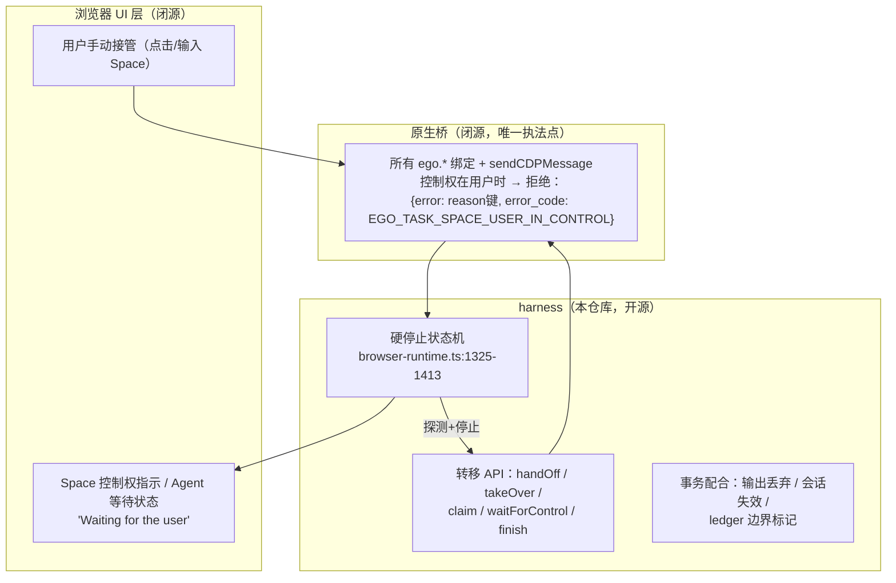

# ego-lite 人机控制权转移：技术原理

> 整理自源码（fork@main d392204，实机 0.6.1.11）+ 本会话 2026-10-25/26 的实测（4 次硬停止、2 次 handOff 扫码、多次 takeOver/claim）。
> 引用相对 `package/ego-browser/`（标注 `docs/` 的除外）。

## 1. 我们实测过的行为（现象层）

| 现象 | 实测场景 |
|---|---|
| 用户一碰空间，agent 下一命令立刻硬停止 | 购物任务中围观/操作 Space 页面，触发 3 次；抖音调试中又 1 次 |
| 硬停止后该轮**所有缓冲输出被丢弃** | 硬停止的轮次 stdout 一个字都不打印（连已执行步骤的 console.log 都没有） |
| 控制状态**跨 agent 进程持久** | 每轮 `ego-browser nodejs` 都是新 Node 进程，但"用户持有控制权"的状态一直保持 |
| agent 无法绕过 | 错误信息明示 "This is a hard stop... do not retry and do not take control back on your own" |
| 需要用户操作时 agent 主动交权 | 闲鱼扫码登录：agent 调 `task.handOff()` 结束该轮，用户扫码后回复，`takeOverTaskSpace(1)` 恢复 |
| 接管在用户未放权时会被拒绝 | 有一次用户回复"继续"但浏览器未放权，`takeOverTaskSpace` 直接被同一个控制错误拒绝 |
| 浏览器 UI 有明确的"等待用户"状态 | 探测时会调用 `setAgentTaskState("Waiting for the user")`（见 §5） |

## 2. 三层架构：执法点只有一处



**核心设计决策**（`src/helpers.ts:126-127`、`144-146` 注释原文）：*"The user-control boundary is enforced at the native bridge when real commands run, not here"* —— harness 里的 JS 策略层**不执法**，只是描述各 API 遇到 user-owned 空间时的行为；真正的控制权检查发生在**每一条真实命令穿过原生桥的时刻**。这意味着没有任何 harness 路径（包括裸 CDP）能绕过它，因为裸 CDP 也走 `ego.sendCDPMessage`。

## 3. 所有权模型：三态

`src/helpers.ts:122-152`：

| ownership | 含义 | 备注 |
|---|---|---|
| `agent` | agent 拥有 | |
| `agentDelegatedToUser` | **agent 的空间，控制权临时在用户手里**（handoff 或 GUI 接管） | 仍算 agent-owned（`isAgentOwned`）：可以选中它，控制权检查交给原生桥 |
| `user` | 用户自己的空间 | agent 想用必须先 `claimTaskSpace`（用户明确要求=批准） |

各 API 对 user-owned 空间的策略（helpers.ts:130-137 的表，与 skill-body 保持同步）：

| API | 对 user-owned 空间的行为 |
|---|---|
| `taskSpace`（按名） | 抛 `EGO_TASK_SPACE_NAME_IN_USE` |
| `switchTaskSpace` | 抛错（仅限 agent-owned） |
| `claimTaskSpace` | **认领（所有权转 agent）**再选中 |
| `handOffTaskSpace` | 跳过，返回 `{done:false, skipped:"user-owned"}` |
| `finish{keep:true}` | 跳过（页面本来就在用户手里） |
| `finish{keep:false}` | 先认领再关闭 |
| `takeOverTaskSpace` / `waitForControl` | 不做所有权检查（按现状操作） |

## 4. 控制边界的统一模型：权限提示 ≡ 手动接管

`docs/native-bindings-api.md:276-318` 定义了原生侧契约——控制权在用户时，绑定调用**不抛异常而是 resolve 一个错误对象**：

```js
{ error: <reason 键>, error_code: 'EGO_TASK_SPACE_USER_IN_CONTROL' }
```

`error` 字段是**稳定的 reason 键**（不是给人看的文案）：

```
notifications  location  camera  microphone  pan_tilt_zoom_microphone
midi  bluetooth  usb  serial  hid  protocol_handler  manual_takeover
```

**这是整个设计最漂亮的一点**：浏览器权限提示（定位/摄像头/通知……这些"只有用户能回答的问题"）和**用户手动接管**走的是同一条控制权通道。对 agent 来说语义统一为"现在轮不到我做决定"；对 UI 来说可以按 reason 键给出不同的引导文案。页面自产的 JS 对话框（alert/confirm）**不走这条路**（有独立的对话框处理，`PageDialogOpenedError`）。

## 5. harness 硬停止状态机（browser-runtime.ts:50-52, 1325-1413）

三个模块级状态：`userControlProbeState: "idle" | "probing" | "stopped"`、`userControlStopError`、`userControlProbeGeneration`（代数计数器防竞态）。

**触发**：`sendCDPMessage` 的错误回调收到 `EGO_TASK_SPACE_USER_IN_CONTROL` 时（:1332-1345）：

1. 已是 `stopped` → 用既有停止错误拒绝**所有**在途命令（硬停止状态持续生效）
2. 已在 `probing` → 等待
3. `idle` → 进入探测 `probeUserControlReason`（:1347-1383）

**探测**——一次调用干两件事：调 `ego.setAgentTaskState("Waiting for the user")`，它既是**UI 通知**（浏览器上显示 agent 在等待用户，就是用户看到的"Agent 已暂停"），其**返回值又是探测结果**：

- 也返回 user-control 错误 → 确认硬停止（`stopForUserControl` :1385-1390：记录停止错误、置 `stopped`、拒绝全部在途命令）
- 成功 → **控制权在命令失败和探测之间已经回来了**（:1371-1375）：不算新的硬停止，把原命令当瞬时错误拒绝即可——这个竞态处理很讲究
- 老运行时没有 `setAgentTaskState` → 直接按兜底信息停止（:1354-1357）

**重新武装**：`handleMessage`（:1436-1440）——处于 `stopped` 时任何一条**成功**的命令响应都证明控制权已回来，`resetUserControlProbe()` 重置探测状态，允许下一次接管触发独立的探测。

**代数计数器**：探测是异步的，期间状态可能再变；`generation` 不匹配的迟到探测结果全部丢弃（:1361, :1377, :1386）。

## 6. 转移路径与 API

### 用户 → agent（恢复）

| API | 实现 | 要点 |
|---|---|---|
| `takeOverTaskSpace(id)` | helpers.ts:488+，`ego.useTaskSpace` 重新选中并恢复 agent overlay | 前提是用户已放权；实测未放权时被原生桥以同一控制错误拒绝 |
| `claimTaskSpace(id)` | helpers.ts:361-384：`ego.claimTaskSpace(id, name)` → **所有权转 agent** → 选中 → `captureTaskSpaceUserBoundary` | 用于 user-owned 空间（含 finish{keep} 留下的）；边界捕获见下 |
| `task.waitForControl()` | page-model.ts:994-1012 | **非侵入式轮询**：在 `gate.withSpace` 内循环调 `probeAgentControl`，默认 interval/timeout 轮询直到可控或超时。probeAgentControl（ego-errors.ts）专为探测设计——"不把预期中的 user-control 响应变成硬停止"，且同时检查 reject 和 `{error, error_code}` resolve 两种失败形态 |

### agent → 用户（交权）

`task.handOff()`（page-model.ts:1015-1027）的完整动作序列：

```
gate.withSpace(spaceId)                 ← 经 NativeOperationGate 串行化
  → #reconcilePages()                   ← 先对账页面清单
  → ledger.beginUserControl(spaceId)    ← 记录边界标记（可回滚）
  → ego.handOffTaskSpace()              ← 原生交权，隐藏 agent overlay
  → #stopBackgroundPageDiscovery()      ← 停掉后台页面发现
  （失败则 ledger.cancelUserControl 回滚边界）
```

### 边界标记：交接不是失忆（page-ledger.ts:259, 526-532）

`beginUserControl` 写入 `handoffBaseline` 边界标记；claim/takeOver 时 `captureTaskSpaceUserBoundary` 捕获"用户持有控制权期间"的现场。这就是 `task.userPage()` 能返回"**认领/接管边界上用户正活跃的那个标签页**"的机制（public-api-schema 里的描述），也是 `listTaskSpaces` 能给出 `recentTabTitles` 的来源——agent 恢复后不是从零观察，而是知道用户停在哪。

### 收尾

`finish({keep})`（page-model.ts:1030+）：keep=false 关闭空间；keep=true 页面留给用户、空间转为后续可 `claimTaskSpace` 恢复的形态（实测：finish 后 Page 标签失效、保留标签页变非托管 tab，恢复需 claim + `tabs()`/`adopt`）。

## 7. 事务性配合：为什么硬停止"干净"

1. **输出丢弃**：`cliLog` 本来就走缓冲（output-sink），脚本以抛错结束时 `flushSink(stdout, true)` **丢弃全部缓冲**（run.ts:106-113）——硬停止的那一轮半成品输出不会泄漏给 agent，唯一的信号就是那条带恢复指引的硬停止错误
2. **会话失效**：接管/换空间经 `wrapUseTaskSpace`/`wrapInvalidating`（index.ts:200-224）触发 `invalidateSession + clearPreferredTarget`——旧会话全部作废，不存在"拿着旧会话继续操作"的灰色地带
3. **并发门**：`NativeOperationGate`（native-gate.ts）用 AsyncLocalStorage + FIFO 把"选空间+命令"整体串行化，控制权探测不会与其他空间的操作交错
4. **硬停止语义写进错误文案**：错误信息直接教 agent 该怎么办（等用户、用 takeOverTaskSpace 恢复、不要自己抢回）——这是给 LLM 的协议，不只是给人的报错

## 8. 为什么体验好（设计原则总结）

1. **单一执法点**：控制权检查在原生桥、逐命令执行——任何路径都绕不过（连 raw CDP 也在内），agent 侧没有"侥幸通道"也就没有抖动
2. **统一语义**：权限提示和手动接管同源（reason 键体系），"只有用户能决定的事"是一等公民概念，UI 与 SDK 共用同一套词汇
3. **探测即通知**：`setAgentTaskState` 一次调用同时完成 UI 呈现和状态探测，没有独立的"通知通道"要维护
4. **状态住在浏览器，进程随便换**：控制权是浏览器侧持久状态，agent 每轮新进程无妨——人机协作的连续性不依赖 agent 会话存活
5. **交接有记忆**：ledger 边界标记 + userPage() + recentTabTitles，agent 回来时知道用户停在哪，不是重启而是续谈
6. **事务性轮次**：输出缓冲+丢弃、会话作废、背景发现停止，硬停止不留半成品状态
7. **对 LLM 友好的协议化错误**：错误码稳定（`EGO_TASK_SPACE_USER_IN_CONTROL`）、reason 是键不是文案、错误信息自带恢复脚本——agent 的正确行为是"被设计出来的"，不是靠模型自觉

## 9. 源码索引

| 环节 | 位置 |
|---|---|
| 所有权三态 + API 策略表 | `src/helpers.ts:122-152` |
| 硬停止状态机 / 探测 / 重新武装 | `src/browser-runtime.ts:50-52, 1325-1413, 1436-1440` |
| user-control 错误识别 / 非侵入探测 | `src/ego-errors.ts`（`isEgoUserControlError` / `probeAgentControl`） |
| `task.handOff()` / `waitForControl()` | `src/page-model.ts:994-1027` |
| claim / takeOver / complete v1 助手 | `src/helpers.ts:361-500` |
| 边界标记（handoffBaseline） | `src/page-ledger.ts:259, 526-532` |
| 原生侧控制契约（reason 键表） | `docs/native-bindings-api.md:276-318` |
| 会话失效包装 | `src/index.ts:200-224` |
| 空间选择串行化 | `src/native-gate.ts` |
| agent 侧使用规范 | `skill-body/SKILL.md`（"User control and completion" 节） |

## 附录 A：外部层（CDP）可实现性分析

> 回答"这种机制是不是只能在浏览器层实现"。判据一句话：**要区分的信息诞生在哪一层，完美处理就得在哪一层。**

### A.1 可以在 CDP/外部层实现的能力

| 能力 | 外部实现方式 | 说明 |
|---|---|---|
| 控制权状态机 + 命令闸门 | 外部 harness 自己就是全部 CDP 流量的**唯一出口**，在客户端里实现同款状态机反而更简单 | ego 把执法点放原生桥不是为了技术必要，而是收益最大化（见 A.3） |
| 用户操作检测 | `Page.addScriptToEvaluateOnNewDocument` 注入捕获阶段监听（pointerdown / wheel / keydown） | **关键坑**：CDP 注入的输入 `isTrusted` 也是 `true`（走同一输入管线），不能靠 isTrusted 区分——要用"agent 派发前打标记、事件回调里查标记"的相关性法：不在自己派发窗口内的输入 = 真人。有竞态窗口但可控 |
| 反向锁（agent 专属模式） | `Input.setIgnoreInputEvents(true)` 让浏览器忽略物理输入 | ego 不用这个方向（允许用户随时插手），但外部工具可拿来做"agent 作业中"模式 |
| 状态跨 agent 进程持久 | 常驻 daemon 持有状态（如 TreeWalker 的 BrowserSession 角色） | ego 用浏览器进程本体当 daemon |
| JS 对话框处理 | `Page.javascriptDialogOpening` 事件原生就在 CDP 里 | ego 特意**不**把 JS 对话框算进控制权（独立通道），这个设计本身是对的 |
| 界面状态指示（近似） | 注入 fixed 定位 DOM overlay（"当前由 Agent 控制"横幅），不少 agent 框架即此做法 | 体验打折，见 A.2 第 3 条 |

### A.2 难以/无法外部复刻的能力（引擎层的护城河）

| 能力 | 为什么外部做不到 | 细节 |
|---|---|---|
| **权限提示统一进控制协议**（reason 键体系） | 权限提示是浏览器 UI 层的东西：外部 CDP 客户端收不到"提示已弹出"的事件，也不能把决定权交还用户 | `Browser.grantPermissions` 走**自动授权**（Playwright 模式），"只有用户能决定"的语义直接丢失。ego 能把 location/camera/manual_takeover 塞进同一错误码协议，因为提示诞生在它自己家里 |
| **输入源头的零竞态区分** | 物理输入与协议注入的**分叉点在浏览器输入管线内部** | 引擎在那儿一目了然（`manual_takeover` 即时）；外部只能靠时间窗相关性启发式，存在误判窗口。实践够用，但非结构性正确 |
| **原生级常显 UI** | 页面 DOM 内的指示器不可信 | 页面可能还在加载、CSP 与注入样式打架、全屏视频盖住 overlay、每个标签页要各自注入。ego 的指示在窗口 chrome / Space 层，永远可见全局一致；agent 光标可视化（带动作 label 的可见鼠标）同理 |
| **Space 与真实 profile 共享**（附带） | "agent 在自己空间干活但用真实登录态"两头占 | 外部 `Target.createBrowserContext` 能隔离但不能共享真实 profile 的 cookie 存储；直连用户在用的 Chrome 则失去隔离 |

### A.3 结论

**功能等价可以外部做到，体验等价做不到。** 状态机、闸门、检测、持久化、近似 UI，一个标准的"daemon + 注入监听 + CDP 客户端闸门 + overlay 横幅"外部栈今天就能拼出来。

ego 把执法点放原生桥的收益拆解：**不是必须，而是三份白嫖**——逐命令检查的零开销、浏览器进程长存（天然 daemon）、与权限系统同源（reason 键才可能统一）。对外部实现者而言，最值得抄的是它的**协议设计**（reason 键体系 + 错误信息内嵌恢复脚本的"给 LLM 的协议"），而不是实现位置——协议设计才是框架无关的。

