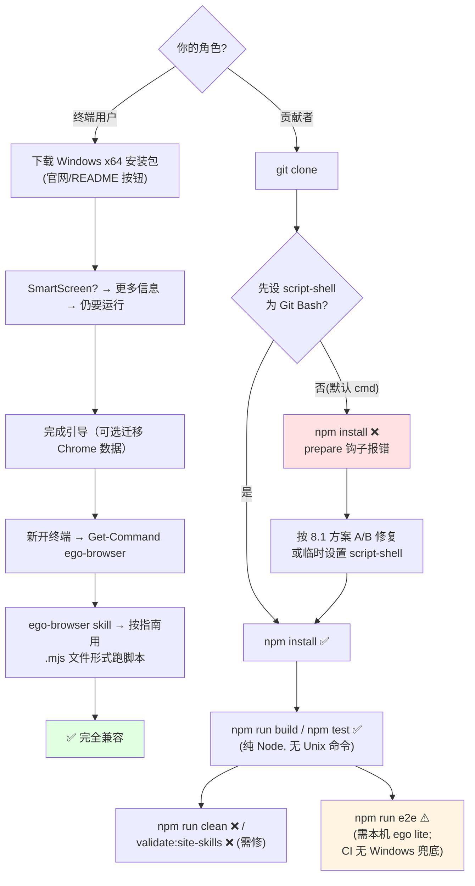

# ego-lite (ego-browser) - Windows 兼容性分析

> 生成时间: 2026-10-25
> 原始数据: `out/05-Windows兼容性检查.md`（技能脚本扫描）+ 源码逐项验证

## 总体评估

| 指标 | 结果 |
|------|------|
| 总体评级 | ⚠️ 部分兼容 —— **终端用户 ✅ 完全兼容；贡献者开发工作流 ⚠️ 有 1 个高危卡点** |
| 高危问题 | 1（`prepare` 钩子 POSIX 语法，Windows `npm install` 失败） |
| 中危问题 | 3（`clean`/`validate:site-skills` 脚本、CI 无 Windows） |
| 低危问题 | 4 |
| 已正确适配项 | 10+ |

### 评级说明

| 等级 | 含义 |
|------|------|
| ✅ 完全兼容 | 项目可在 Windows 上正常构建和运行 |
| ⚠️ 部分兼容 | 可构建但部分功能不可用，需少量修复 |
| ❌ 不兼容 | 无法在 Windows 上构建或核心功能不可用 |

本项目需**分两个角色**评估：

- **终端用户**（安装 ego lite 应用 + 让 Agent 使用）：官方提供 Windows x64 安装包（README 下载按钮、install.md Windows 专节），运行时代码有完整 Windows 分支（剪贴板 PowerShell 宿主、平台修饰键、PATH 处理），**✅ 完全兼容**。
- **贡献者**（clone 后 `npm install` / `npm test`）：`prepare` 生命周期钩子使用 POSIX 语法，在 Windows 默认 script-shell（cmd.exe）下 `npm install` 直接失败，**⚠️ 有构建阻断级问题**（有已知 workaround，见 8.1）。

## 1. 构建系统兼容性

### 1.1 package.json Scripts

| Script | 命令 | 问题 | 严重程度 |
|--------|------|------|----------|
| `prepare` | `if [ "$CI" = "true" ]; then exit 0; fi; cd ../.. && lefthook install` | `[ ... ]`、`$CI`、`then/fi` 均为 POSIX sh 语法，cmd.exe 无法解析 → **Windows 上 `npm install` 报错**（CI=true 时才跳过） | 🔴 HIGH |
| `clean` | `rm -rf dist artifacts` | cmd 无 `rm` 命令 | 🟡 MEDIUM |
| `validate:site-skills` | `npm run build && EGO_BROWSER_AGENT_WORKSPACE=../../skills/ego-browser node dist/scripts/validate-site-skills.js` | `VAR=value cmd` 环境变量前缀是 POSIX 语法，cmd 不支持 | 🟡 MEDIUM |
| `build` | `node scripts/build.mjs` | 纯 Node 实现（node:fs/promises 的 rm/cp/mkdir），跨平台 | ✅ |
| `test` | `npm run build && ... && node --test "src/**/*.test.mjs"` | 引号内 glob 由 Node 22 自行展开，跨平台 | ✅ |
| `style:check` / `typecheck` / `e2e` | prettier / tsc / node 脚本 | 跨平台 | ✅ |

### 1.2 生命周期 Hooks

| Hook | 命令 | 问题 | 严重程度 |
|------|------|------|----------|
| `prepare` | 见上 | 见上 | 🔴 HIGH |

`prepare` 在 `npm install` 和 `git clone` 后自动运行，属于必须跨平台兼容的钩子（WINDOWS_COMPAT.md §1 关键清单首位）。CI 中用 `CI=true` 短路，故 Linux CI 无感；Windows 本地开发必踩。

### 1.3 构建工具链

| 工具 | Windows 支持 | 说明 |
|------|-------------|------|
| esbuild 0.28 | ✅ | 官方预编译 win32 二进制，无需编译 |
| rollup 4 | ✅ | 原生二进制为 optionalDependencies（`@rollup/rollup-win32-x64-msvc`），npm 自动按平台安装；失败时回退 WASM |
| TypeScript / prettier / lefthook | ✅ | 纯 JS；lefthook 官方支持 Windows |
| acorn（唯一生产依赖） | ✅ | 纯 JS，无原生模块 |
| `scripts/build.mjs` | ✅ | 全部用 `node:fs/promises`；`chmod(0o755)`（build.mjs:110）在 Windows 为安全 no-op |

## 2. 源代码兼容性

### 2.1 child_process 调用

| 文件 | 位置 | 调用方式 | 问题 |
|------|------|----------|------|
| `src/clipboard.ts:141` | spawn `/usr/bin/osascript` | darwin 专用分支，Windows 不会走到 | ✅ 无问题 |
| `src/clipboard.ts:177-192` | spawn `powershell.exe`（绝对路径，`windowsHide: true`） | **教科书级 Windows 适配**（见 §7） | ✅ |
| `scripts/real-browser-e2e/run-command.mjs:8` | `spawn(command, args)`（无 shell） | 命令为可执行文件路径或 PATH 上的 `ego-browser`；若某安装方式将其做成 `.cmd` 垫片，无 `shell:true` 会 ENOENT。当前 Windows 安装器注册的是可执行命令，属**潜在**风险 | 🟢 LOW（仅 E2E 开发场景） |
| `plugins/scripts/package-plugins.mjs:3` | `spawnSync` | 打包脚本，具体命令未逐行核验 | 🟢 LOW |

### 2.2 平台相关代码

| 文件 | 位置 | 问题类型 | 说明 |
|------|------|----------|------|
| `src/state.ts:13` | `platform: process.platform` | 平台感知（好） | 状态单例集中记录平台，测试可覆写 |
| `src/driver/page-actions.ts:778` | `(services.platform ?? process.platform) === "darwin"` | darwin 分支 | 非 darwin（含 win32）走通用路径 ✅ |
| `src/driver/page-keyboard.ts:294,546` | 平台参数默认 `process.platform` | 修饰键映射 | macOS 用 Meta、其余（含 Windows）用 Control ✅ |
| e2e cases（`keyboard.mjs:41` 等 6 处） | `process.platform === "darwin" ? ... : ...` | 同上 | Windows 走 Control 分支 ✅ |
| `scripts/real-browser-e2e/ego-browser-cli.mjs:14` | darwin 才探测固定路径，否则 PATH | CLI 解析 | Windows 回退 `ego-browser` ✅（见 2.1 第 3 行的潜在垫片问题） |

### 2.3 Unix 专用 API

| API | 文件 | 行号 | Windows 替代方案 |
|-----|------|------|-----------------|
| `/usr/bin/osascript`（JXA） | `src/clipboard.ts` | 141 | 已内建替代：Windows PowerShell 宿主（118-119 平台分派） |
| `run-command.mjs` `child.kill("SIGINT")` | run-command.mjs | 17 | Windows 无真实 SIGINT，Node 将其实现为强制终止——E2E 超时杀进程的功能语义保留，仅拿不到优雅退出。LOW |

## 3. 文件系统兼容性

### 3.1 路径处理

| 问题 | 文件 | 行号 | 说明 |
|------|------|------|------|
| `~` 展开 | `src/env.ts` | 22-30 | **已正确适配**：`process.env.HOME \|\| process.env.USERPROFILE`，Windows 命中 USERPROFILE ✅ |
| PowerShell 路径拼接 | `src/clipboard.ts` | 210-218 | 用 `win32.join(SystemRoot ?? "C:\\Windows", ...)`，显式 win32 命名空间，不依赖运行平台 ✅ |
| 路径分隔符硬编码 | 全 src 扫描 | — | 未发现 `split('/')`、`+ '/' +` 类硬编码 ✅ |
| 临时目录 | skill 文档 | — | `$TMPDIR` / `$env:TEMP` 两种写法均已文档化 ✅ |

### 3.2 符号链接

未使用 `fs.symlink`。构建用 `cp`（`build.mjs:104-109`）复制 Skill，无链接权限问题 ✅。

## 4. Shell 和脚本兼容性

### 4.1 Shell 脚本

| .sh 文件 | 对应 .ps1 | 对应 .cmd | 说明 |
|----------|-----------|-----------|------|
| `skills/ego-browser/scripts/install.sh` | ✗ | ✗ | **有意只支持 macOS**：脚本开头 `uname -s = Darwin` 守卫并明确提示"Windows 请到 https://lite.ego.app/ 下载"；references/install.md 有 Windows 专节（手动下载 + SmartScreen 处理）。属产品决策而非缺陷 |
| `package/ego-browser/scripts/repro-popup-foreground.sh` | ✗ | ✗ | 开发者复现调试脚本（前台弹窗场景），macOS 场景专用。LOW |

### 4.2 环境变量

| 变量 | 文件 | 行号 | 问题 |
|------|------|------|------|
| `EGO_BROWSER_AGENT_WORKSPACE` | env.ts:10 | — | 读取方式跨平台 ✅ |
| `VAR=value cmd` 前缀写法 | package.json `validate:site-skills` | 18 | cmd 不支持，见 1.1 |
| `CI` 短路 | package.json `prepare` | 14 | 语法问题见 1.1；`CI` 变量本身在 Windows npm 同样可用 |
| `SystemRoot` 回退 | clipboard.ts:212 | — | `process.env.SystemRoot ?? "C:\\Windows"` 带缺省值 ✅ |

## 5. 测试和 CI/CD 兼容性

### 5.1 CI 配置

| 工作流 | Runner | Windows 支持 | 说明 |
|--------|--------|-------------|------|
| `ci.yml` | ubuntu-latest ×2（test/release） | ✗ 未覆盖 | test 作业跑全部单测；release 作业用 `tar`/`zip`/`mktemp`/`grep`（bash-only，但只在 ubuntu runner 执行，无本机影响） |
| `main-pr-source.yml` | ubuntu-latest | ✗ 未覆盖 | PR 来源检查 |
| `purge-camo-cache.yml` | ubuntu-latest | ✗ 未覆盖 | 缓存清理 |

### 5.2 测试覆盖

| 测试类型 | Windows 是否覆盖 | 说明 |
|----------|-----------------|------|
| 单元测试（36 文件） | CI ✗ / 本机 ⚠️ 可跑 | `npm test` 本身在 Windows 可运行（前提是跨过 prepare 钩子）；但 CI 矩阵无 windows-latest，回归无保障 |
| 真实浏览器 E2E | ✗ | 需要 Windows 上安装真实 ego lite；`EGO_BROWSER_REAL_E2E_CLI` 可指定 CLI 路径 |
| 插件测试 | 同上 | `npm --prefix plugins/ego test` |

代码里有大量 darwin/win32 分支（尤其 clipboard.ts 的 548-663 行 PowerShell 宿主），却没有 Windows CI 兜底——**这是测试盲区**，毕竟 Windows 剪贴板代码只能靠 Windows 环境验证。

## 6. 依赖兼容性

### 6.1 原生模块

| 依赖 | 是否需要编译 | Windows 支持 |
|------|-------------|-------------|
| acorn（生产） | 否（纯 JS） | ✅ |
| esbuild / rollup | 否（预编译二进制） | ✅ |

无 node-gyp、无 node-sass/bcrypt/sharp 类风险包。

### 6.2 可疑依赖

未发现。生产依赖树 = acorn 一个，几乎是"零依赖"运行时。

## 7. 已正确处理的适配

| 适配项 | 文件 | 行号 | 处理方式 |
|--------|------|------|----------|
| Windows 剪贴板宿主 | `src/clipboard.ts` | 172-208 | spawn 绝对路径 `powershell.exe`（SystemRoot 回退），`windowsHide: true` 防闪窗 |
| PowerShell 脚本传参 | `src/clipboard.ts` | 188-190, 665-668 | `-EncodedCommand` + UTF-16LE base64，彻底绕开控制台代码页与引号问题（`-Sta`、`-InputFormat None` 处理 STA 与 stdin 抽干问题） |
| 非 ASCII 载荷 | `src/clipboard.ts` | 197-202 | 内容走 base64 行传输，"Base64 lines keep the payload independent of console code pages" |
| HTML 剪贴板封套 | `src/clipboard.ts` | 224-250 | 手工构造 Windows `HTML Format` 头，偏移按 **UTF-8 字节** 计算 |
| 免编译 P/Invoke | `src/clipboard.ts` | 563-579 | `GetClipboardSequenceNumber` 用 Reflection.Emit 绑定，避免 Add-Type 启动 C# 编译器（首次调用慢） |
| 跨进程剪贴板锁 | `src/clipboard.ts` | 615-627, 659 | Windows 命名互斥体 `Local\ego-browser-clipboard`（对应 macOS NSDistributedLock），处理 AbandonedMutexException |
| 剪贴板恢复重试 | `src/clipboard.ts` | 604-612 | Clear 失败重试 10×100ms |
| `~` 路径展开 | `src/env.ts` | 24-27 | `HOME \|\| USERPROFILE` 双回退 |
| 修饰键跨平台 | `page-keyboard.ts` 等 | 294, 546 | platform 参数化，Windows 用 Control 而非 Meta |
| 用户文档双 shell 指南 | `skill-body/SKILL.md` | 43-81 | PowerShell 5.1 引号丢失/ANSI 编码/无 `<` 重定向的完整规避方案（`.mjs` 文件 + `file:///` 导入）；cmd 用 `<` 重定向 |
| 安装文档 Windows 专节 | `references/install.md` | 38-49, 106-110 | 手动下载指引、SmartScreen 处理、"新开终端才见 PATH"提示 |
| 指南截断检测的 PowerShell 变量 | `skills/ego-browser/SKILL.md` | 24-25 | 同时给出 `$TMPDIR` 与 `$env:TEMP` 两种写法 |

## 8. 修复建议

### 8.1 必须修复 (HIGH)

**`prepare` 钩子（package.json:14）** — Windows `npm install` 阻断：

```jsonc
// 现状（POSIX-only）
"prepare": "if [ \"$CI\" = \"true\" ]; then exit 0; fi; cd ../.. && lefthook install"

// 方案 A（推荐）：逻辑移入跨平台 Node 脚本
"prepare": "node scripts/prepare.mjs"
// scripts/prepare.mjs:
//   if (process.env.CI === "true") process.exit(0);
//   execFileSync("npx", ["lefthook", "install"], { cwd: "../..", shell: true });

// 方案 B（最小改动）：cmd 兼容写法（cd 与 && 在 cmd 均合法）
"prepare": "node -e \"if(process.env.CI==='true')process.exit(0)\" && cd ../.. && npx lefthook install"
```

**用户侧临时解法**（不必改代码即可安装）：把 npm 的 script-shell 指向 Git Bash：

```powershell
npm config set script-shell "C:\Program Files\Git\bin\bash.exe"
```

### 8.2 建议修复 (MEDIUM)

1. **`clean` 脚本**（package.json:10）：`rm -rf dist artifacts` → `node -e "require('node:fs').rmSync('dist',{recursive:true,force:true});require('node:fs').rmSync('artifacts',{recursive:true,force:true})"`。
2. **`validate:site-skills`**（package.json:18）：把 `EGO_BROWSER_AGENT_WORKSPACE=...` 前缀移进脚本内部（`process.env.EGO_BROWSER_AGENT_WORKSPACE ??= resolve("../../skills/ego-browser")`），或使用 `cross-env`。
3. **CI 增加 Windows 矩阵**：至少让 `test` 作业在 `windows-latest` 上跑（node 22 + npm ci + style:check + npm test；E2E 与 release 保持 ubuntu）。剪贴板/键盘的 win32 分支目前只有 Windows 手动测试在覆盖。

### 8.3 可选改进 (LOW)

1. `repro-popup-foreground.sh` 无 Windows 等价物——若该调试场景在 Windows 也有意义，补 `.ps1` 或改写为 Node 脚本。
2. E2E `run-command.mjs` 的 `spawn(command)`：如未来 Windows 分发出现 `.cmd` 垫片，需 `shell: true` 或显式 `.cmd` 回退；可先在文档注明要求 PATH 上为可执行文件。
3. `run-command.mjs:17` 的 `SIGINT`：Windows 上是强制终止；如需优雅超时，可改为向 stdin 写 Ctrl-C 事件或用 `taskkill`。
4. lefthook 的 pre-commit 脚本段（`git fetch … || { …; }`、`$(...)`）是 bash 语法：lefthook 在 Windows 会尝试用系统 shell 执行而失败。贡献者可用同一 script-shell workaround；长期可在 lefthook.yml 为 win32 指定 `shell: bash`（Git Bash 依赖）或改用 skip 机制。

## 9. 兼容性流程图



**结论**：把 `prepare` 钩子改成跨平台写法 + 补一条 Windows CI，这个仓库即可从"⚠️ 部分兼容"升级为"✅ 完全兼容"。运行时侧（尤其剪贴板事务的 PowerShell 宿主）已经是同类开源项目里少见的精细 Windows 适配水平。
