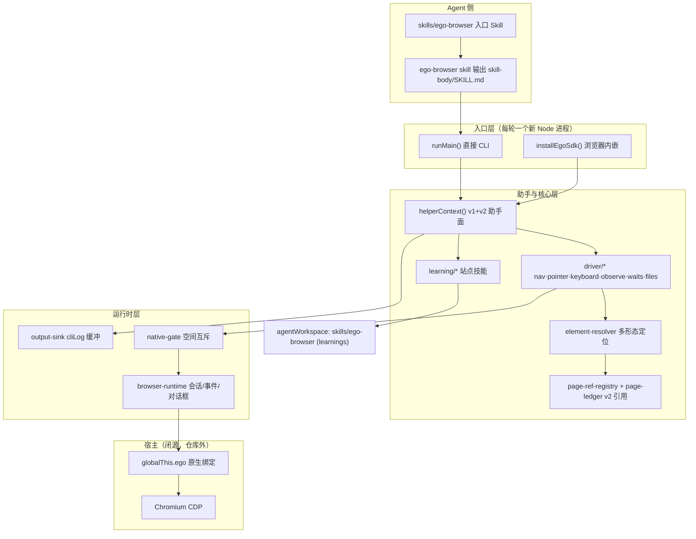
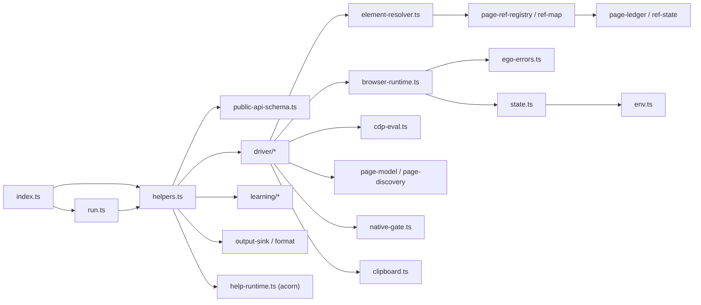
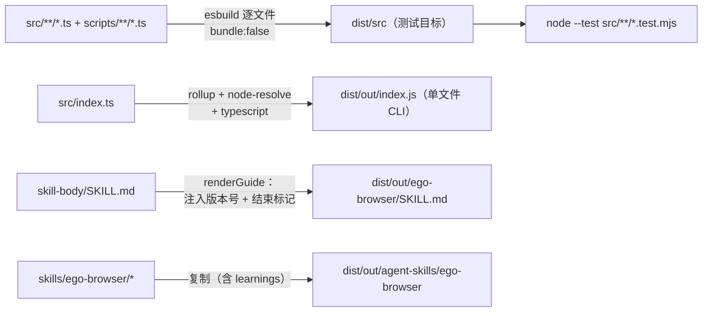

# ego-lite (ego-browser) - 架构分析

> 生成时间: 2026-10-25
> 分析对象: citrolabs/ego-lite（main 分支，提交 d392204）
> 原始数据: `out/01-项目信息.md` ~ `out/03-依赖分析.md`（技能脚本输出 + 源码人工验证）

## 1. 项目概览

### 1.1 项目信息

| 项目 | 内容 |
|------|------|
| 仓库 | citrolabs/ego-lite |
| npm 包名 | `ego-browser-v2` (v0.1.0) |
| 语言 | TypeScript（纯 ESM，Node.js ≥ 22） |
| 类型 | AI Agent 浏览器自动化 harness + Agent Skill 分发包 |
| 描述 | Node.js CDP 浏览器自动化线束：通过 ego lite 浏览器注入的 `globalThis.ego` 原生绑定驱动浏览器，暴露紧凑的快照/引用（snapshot/ref）工作流，并叠加可复用的站点经验（learnings） |
| 许可证 | MIT（本仓库内容）；ego lite 浏览器本体为独立免费下载的闭源应用 |

**关键定位**：本仓库**不含浏览器本体**。浏览器由 ego lite 桌面应用（闭源）提供；应用自带 `ego.sendCDPMessage` 等原生绑定，并内嵌一份由本仓库构建的 `ego-browser` 单文件二进制。`docs/native-*.md` 系列文档定义了浏览器侧必须满足的原生契约。

### 1.2 代码规模（脚本统计 + 人工核对）

| 指标 | 数值 |
|------|------|
| `src/` 下 TypeScript 文件 | 44 个，约 20,965 行 |
| 单元测试文件（`*.test.mjs`，与源码同目录） | 36 个，约 18,161 行 |
| 真实浏览器 E2E 用例（`scripts/real-browser-e2e/cases/`） | 37 个 |
| 站点学习包（`skills/ego-browser/learnings/`） | 3 个：github / google / x-com |
| 多语言 README | 9 种 |

测试代码约占源码的 86%，测试文化非常重。

### 1.3 目录结构

```
ego-lite/
├── package/ego-browser/        # 核心 npm 包（唯一构建目标）
│   ├── src/
│   │   ├── index.ts            # 双入口分流：CLI / installEgoSdk
│   │   ├── run.ts              # stdin JS 执行器
│   │   ├── helpers.ts          # v1 + v2 助手面组合
│   │   ├── public-api-schema.ts# v2 API 唯一事实来源
│   │   ├── browser-runtime.ts  # CDP 传输 / 会话 / 事件缓冲
│   │   ├── element-resolver.ts # @N / loc= / xpath / CSS 解析
│   │   ├── page-ref-registry.ts / page-ledger.ts / ref-map.ts / ref-state.ts
│   │   ├── native-gate.ts      # 进程级任务空间互斥门
│   │   ├── clipboard.ts        # 跨平台剪贴板事务
│   │   ├── env.ts / state.ts   # 工作区解析 / 共享状态单例
│   │   ├── driver/             # nav·pointer·keyboard·observe·waits·files·element-ops·downloads…
│   │   ├── learning/           # 站点学习子系统
│   │   └── *.test.mjs          # 测试与源码同目录（无独立 test/ 目录）
│   ├── scripts/                # build.mjs / validate-site-skills.ts / real-browser-e2e/
│   ├── skill-body/SKILL.md     # `ego-browser skill` 打印的使用指南（551 行，带版本号）
│   └── dist/                   # 构建产物（dist/src + dist/out）
├── skills/ego-browser/         # 对外发布的"薄入口 Skill"
│   ├── SKILL.md                # 只做一件事：指示运行 `ego-browser skill`
│   ├── references/             # install.md / clearing-state.md
│   ├── scripts/install.sh      # macOS 安装脚本（Windows 走官网下载）
│   └── learnings/<site>/       # manifest.json + notes/ + tools/ + browser-tools/
├── plugins/ego/                # 多 IDE 插件适配（Claude/Codex/Cursor/CodeBuddy…）+ 自带测试
├── docs/                       # 架构图 + 4 份浏览器侧原生契约文档 + 本地开发指南
├── .github/workflows/          # ci.yml / main-pr-source.yml / purge-camo-cache.yml（均 ubuntu）
├── spec/                       # agent-skills 规范
└── README.md + 8 个翻译版     # 项目门面
```

## 2. 架构设计

### 2.1 架构模式

自动化脚本未能归类（monorepo 布局 + 非框架项目），人工分析识别出以下组合模式：

1. **宿主桥接（Host Bridge）**：所有浏览器能力经由宿主注入的 `globalThis.ego` 原生绑定（`sendCDPMessage`、`createTab`、`useTaskSpace`…）。本仓库不连接浏览器进程、不管理浏览器生命周期——这是它与 Playwright/Puppeteer 类库的根本差异。
2. **双入口、单实现**：`src/index.ts:146-157` 按执行方式分流——直接以 CLI 运行走 `runMain()`（从 stdin 读 JS）；被浏览器应用作为模块导入走 `installEgoSdk(globalThis)`。两条路径共享同一个 `helperContext()` 助手面，从结构上杜绝 CLI 与 SDK 行为漂移（`src/run.ts:149-163` 有明确注释）。
3. **Schema 驱动 API**：`src/public-api-schema.ts:58` 的 `PUBLIC_API_SCHEMA` 是 v2 API 的唯一事实来源；运行时选项校验、`help()` 输出、文档生成共用同一份元数据。v1 兼容面单独冻结在 `helpers.ts`。
4. **注册表 / 账本模式**：v2 页面引用（`@21` 形式的短引用）是 SDK 分配的 id，绑定到具体 frame/document/backend node；`page-ref-registry.ts` + `page-ledger.ts` 的映射跨轮次持久——部分快照按节点身份合并，全量快照整体替换。v1 原生引用刷新行为由 `ref-map.ts` + `ref-state.ts` 保留。
5. **共享状态单例**：`src/state.ts:9-19` 是全局可变运行时状态（platform、now、sleep、writeFile、preferredTargetId、networkDomainEnabled…）；测试通过 `setOverrides()` 注入替身后可恢复。
6. **驱动分层**：`src/driver/` 按交互能力划分模块（nav / pointer / keyboard / observe / waits / files / element-ops / downloads / page-*），全部构建在 browser-runtime 与 element-resolver 之上。
7. **声明式插件（学习系统）**：`skills/ego-browser/learnings/<site>/manifest.json` 声明站点技能，运行时发现→校验→执行（`runSiteTool` / `runSiteBrowserTool` / `learnContext`），并有独立校验器保证"站点形状"约束。
8. **多宿主分发**：`plugins/ego/` 为 Claude Code、Codex、Cursor、CodeBuddy 等生成适配清单，全部复用同一个 Skill 本体。

### 2.2 核心模块

| 模块 | 职责 | 关键文件 |
|------|------|----------|
| 入口 / SDK 安装 | 双入口分流、helper 安装、原生方法包装（防双重包装） | `src/index.ts` |
| 脚本执行 | stdin 读取、AsyncFunction 沙箱注入、语法错误定位 | `src/run.ts` |
| 助手面 | v1+v2 助手组合、agent 模块加载 | `src/helpers.ts`、`src/public-api-schema.ts` |
| CDP 传输 | 会话缓存（2s TTL）、事件缓冲（10k 上限）、JS 对话框门控、会话丢失自动重附 | `src/browser-runtime.ts` |
| 表达式求值 | `cdp()` / `js()` 字符串表达式（顶层 return 自动包 IIFE） | `src/cdp-eval.ts` |
| 元素解析 | `@N` / `loc=css:` / `loc=role:` / `loc=href:` / `xpath=` / 原生 CSS；失败分类 transient/permanent | `src/element-resolver.ts` |
| 引用系统 | v2 SDK 引用注册与跨轮持久 | `src/page-ref-registry.ts`、`src/page-ledger.ts` |
| v1 兼容引用 | 原生引用刷新 | `src/ref-map.ts`、`src/ref-state.ts` |
| 页面模型 | TaskSpace / Page 抽象、标签管理、tab 发现 | `src/page-model.ts`、`src/page-discovery.ts` |
| 驱动层 | 导航 / 指针 / 键盘 / 观察 / 等待 / 文件上传 / 元素操作 / 下载 | `src/driver/*` |
| 并发门 | `NativeOperationGate`：AsyncLocalStorage + FIFO，序列化进程级"已选任务空间" | `src/native-gate.ts` |
| 学习系统 | 站点技能发现 / 格式校验 / 执行 | `src/learning/*` |
| 运行环境 | agent 工作区解析、`.env` 加载、状态单例 | `src/env.ts`、`src/state.ts` |
| 输出管道 | cliLog 缓冲、退出冲刷、硬停丢弃 | `src/output-sink.ts`、`src/format.ts` |
| 文档 | 运行时用 acorn 解析构建产物 JSDoc 生成 `help()` | `src/help-runtime.ts` |
| 剪贴板 | `page.keyboard.paste` 事务：保存→注入→恢复（macOS JXA / Windows PowerShell 双宿主） | `src/clipboard.ts` |
| 迁移守卫 | 旧版 `ego-browser` 的可操作报错 | `src/skill-migration.ts` |

### 2.3 架构图



## 3. 依赖关系分析

### 3.1 外部依赖（`package/ego-browser/package.json`）

| 依赖 | 版本 | 类别 | 用途 |
|------|------|------|------|
| acorn | ^8.16.0 | **生产（唯一）** | JS 解析：`help()` 的 JSDoc 提取（help-runtime.ts）、用户脚本语法错误行号恢复（run.ts:117-147） |
| esbuild | ^0.28.1 | 开发 | 逐文件转译 TS → `dist/src`（测试运行目标） |
| rollup | ^4.60.4 | 开发 | 打包单文件 CLI `dist/out/index.js` |
| @rollup/plugin-node-resolve | ^16.0.3 | 开发 | rollup 依赖解析 |
| @rollup/plugin-typescript | ^12.3.0 | 开发 | rollup TS 编译 |
| tslib | ^2.8.1 | 开发 | TS 运行时助手 |
| typescript | ^5.8.3 | 开发 | `npm run typecheck`（tsc --noEmit） |
| @types/node | ^22.15.29 | 开发 | Node 类型 |
| prettier | ^3.8.4 | 开发 | `style:check` |
| lefthook | ^2.1.9 | 开发 | git hooks（`prepare` 阶段安装，CI 跳过） |

### 3.2 模块依赖图（主数据流方向）



### 3.3 依赖健康度

| 类别 | 数量 | 说明 |
|------|------|------|
| 生产依赖 | **1**（acorn） | 运行时近乎零依赖 |
| 开发依赖 | 9 | 全部为构建/检查工具链 |
| 原生编译依赖 | 0 | 无 node-gyp 类包；esbuild/rollup 在主流平台均有预编译二进制 |
| 高风险/过时依赖 | 未发现 | 无 node-sass/bcrypt 类问题包 |

rollup 打包时仅将 Node 内建模块设为 external（`scripts/build.mjs:81`），产物是自包含单文件——这是浏览器应用能直接内嵌的原因。另注意仓库根没有 package.json，`plugins/ego` 有独立的 package.json 与测试。

## 4. 构建与测试架构

### 4.1 构建流水线（`scripts/build.mjs`）



- 构建有文件锁（`.build.lock`，wx 打开）防并发构建。
- 指南长度上限 25,000 字符（Claude Code 命令输出保留 30k，留余量）。
- `renderGuide` 用结束标记 `[ego-browser:skill] end of guide` 让 agent 可检测输出截断。

### 4.2 测试体系

| 层级 | 命令 | 说明 |
|------|------|------|
| 单元测试 | `npm test`（= build → check:skill-translation → typecheck → `node --test`） | 测试运行于**构建产物** `dist/src`；行为测试用 `__testing.setOverrides` 或 FakeEgo 替身（如 `helpers.test.mjs`、`page-model.test.mjs`） |
| 站点技能校验 | `npm run validate:site-skills` | 校验 learnings 的站点形状约束 |
| 真实浏览器 E2E | `npm run e2e` | 自包含：构建当前 checkout → `--sdk-path` 注入绝对路径 → 启本地 fixture 服务器 → 独立临时任务空间 → 清理；37 个用例覆盖快照/引用/键盘/弹窗/下载/OOPIF/影子 DOM 等 |
| 插件测试 | `npm --prefix plugins/ego test` | 多宿主插件打包与隔离 |
| CI | `.github/workflows/ci.yml`（ubuntu-latest） | style → audit → test → 插件测试 → 站点技能校验 → （tag 时）打包发布 |

### 4.3 质量门（lefthook pre-commit）

`lefthook.yml` 按暂存文件路径选择性触发：分支新鲜度检查、prettier、npm audit、`npm test` 冒烟、站点技能校验、插件测试、E2E——提交即跑全套对应检查。

## 5. Agent 调用模型（补充：agent 如何"用工具"操控浏览器）

本文档以上均为**代码结构视角**；agent 的实际调用方式是一种与 MCP 工具服务器（如 chrome-devtools-mcp，55 个离散工具、每动作一次调用）截然不同的模型——**代码执行线束**：

```
agent 生成整段 JS ──► ego-browser nodejs（唯一入口命令，每轮一个新 Node 进程）
                     └► AsyncFunction 沙箱：helpers 注入为词法参数
                        脚本内 taskSpace()/page.goto()/page.click()… = 普通函数调用
                        console 输出 ──► cliLog 事务缓冲 ──► 退出时 flush 回 agent 上下文
```

要点：**1 命令 = 1 段程序 = N 个动作**（而非 1 工具 = 1 动作）；API 描述靠 `help()` 按需拉取而非 schema 常驻；跨轮状态（spaceId/Page 标签/@N 引用/控制权）住在浏览器侧而非 harness 进程；工具缺口可用 `page.cdp()` 逃生舱当场补齐。

完整的调用链解剖、与 chrome-devtools-mcp 的 55 工具逐项映射、两种模型的上下文经济学对比，见 **[docs/agent-tooling-model.zh-CN.md](../docs/agent-tooling-model.zh-CN.md)**。
