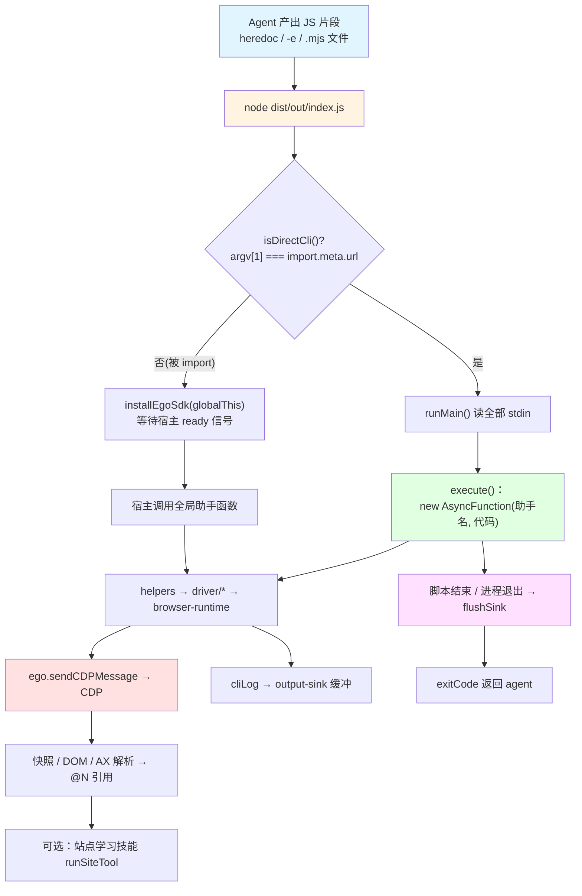
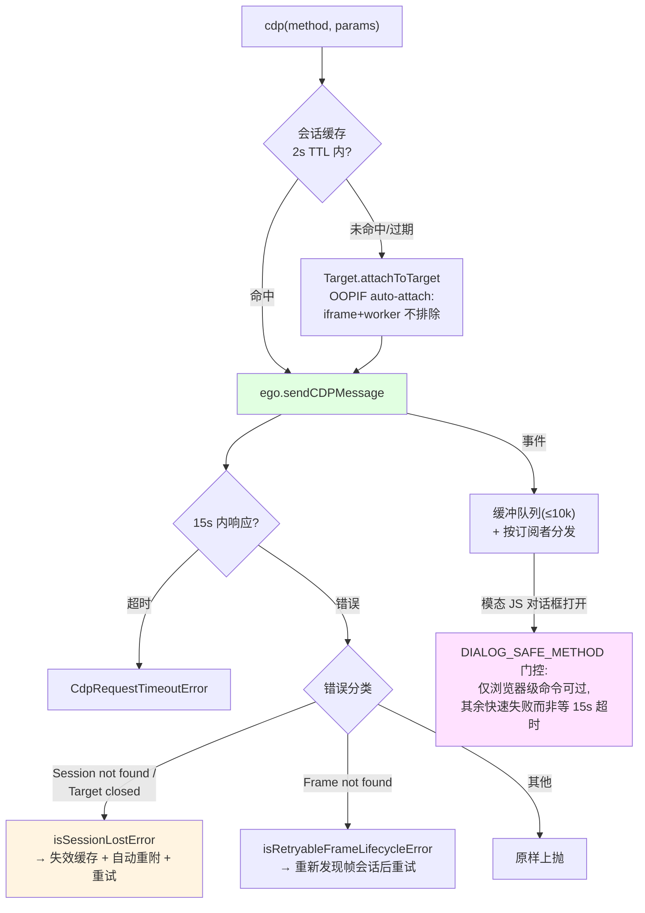
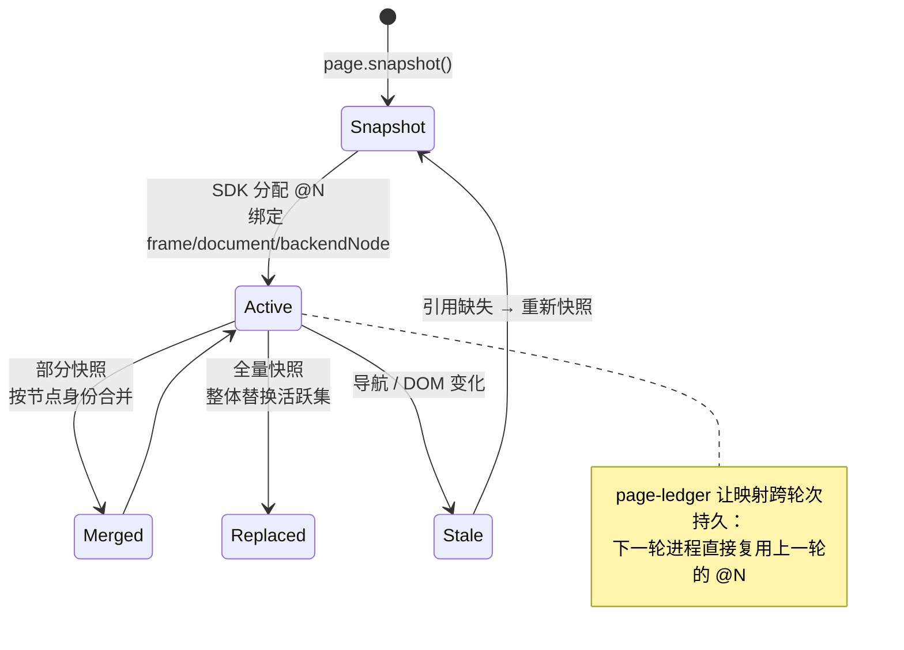
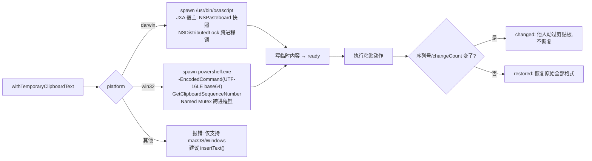
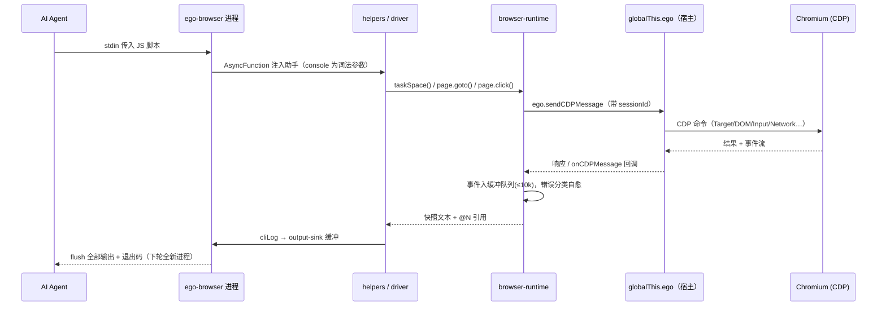
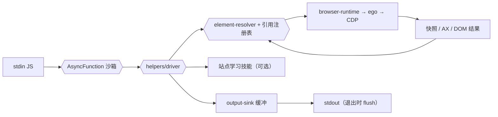
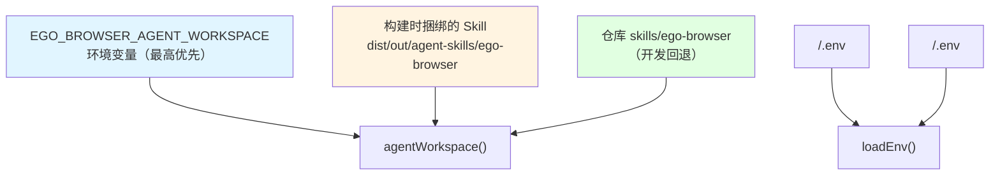
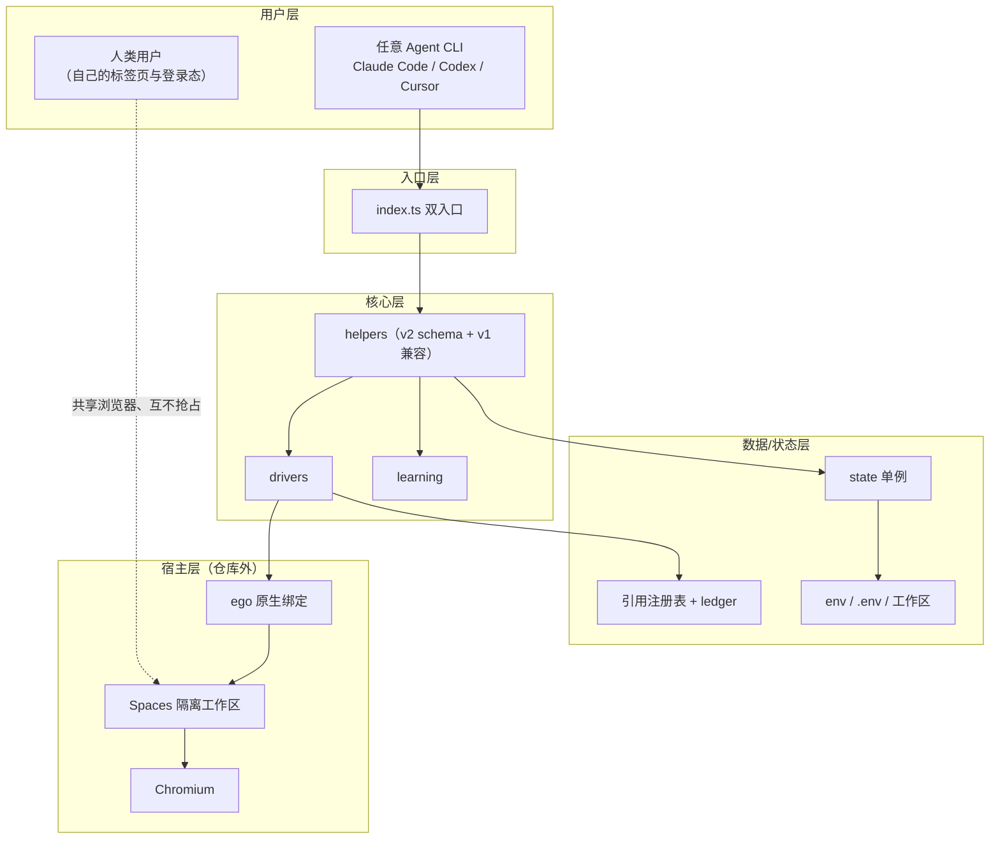

# ego-browser - 运行机制详解

> 生成时间: 2026-10-25
> 原始数据: `out/04-运行时分析.md`（技能脚本输出）+ 源码追踪验证

## 一、项目运行方式

本仓库构建产物 `ego-browser` 以**两种身份**运行，但暴露同一套助手函数：

1. **CLI 身份**（agent 每轮调用）：一个新 Node 进程，从 stdin 读取一段 JavaScript，执行后退出。宿主 app 提供的 `ego-browser` 命令包装了它（支持 `skill` / `nodejs` / `upgrade` 子命令与 `-e` / `--sdk-path` 参数）；本仓库直接构建出的 CLI 则**只接受 stdin**，无子命令（`src/run.ts:66-73`：除 `-h`/`--help` 外任何参数直接打印用法并以退出码 2 结束）。
2. **SDK 身份**（浏览器内嵌）：ego lite 应用把 `dist/out/index.js` 作为模块导入，调用 `installEgoSdk(globalThis)`，在**同一进程**内获得助手函数。

关键点：**每一轮 agent 交互都是一个全新的 Node 进程**——任务空间、标签页、Page 标签会跨轮持久（由浏览器侧保存），但 JS 变量不会；所以使用指南要求 agent 把 `spaceId` / Page label 打印出来供后续轮次恢复。

### 1. 安装与执行

```bash
# 终端用户：安装 ego lite 桌面应用（提供 ego-browser 命令）
#   macOS: sh skills/ego-browser/scripts/install.sh  （或官网下载 DMG）
#   Windows: 官网下载 exe（无安装脚本） https://lite.ego.app/

# 开发者（本仓库）
cd package/ego-browser
npm install        # 注意：prepare 钩子在 Windows cmd 下会失败，见《Windows兼容性分析》
npm run build      # esbuild 逐文件 + rollup 单文件打包
node dist/out/index.js <<'JS'   # 直接运行仓库 CLI（需要 ego 运行时才能真正驱动浏览器）
console.log('hello')
JS

# 测试
npm test           # 单元测试（跑在 dist/src 上）
npm run e2e        # 真实浏览器 E2E
```

### 2. 执行流程（CLI 一轮）



## 二、核心运行机制

### 2.1 双入口与 SDK 安装（`src/index.ts:45-157`）

**说明**：`installEgoSdk()` 把 `helperContext()` 里的每个函数以不可枚举属性挂到目标对象上（`index.ts:83-90`），非同步助手（除 `help`）统一包一层 `await readySignal`——宿主可能在助手被调用前才就绪，甚至以 reject 结束，因此先 `void readySignal.catch(() => {})` 标记已观察、保留同一个 rejection 给每个调用方。

随后对宿主 `ego` 对象做**一次性包装**（`EGO_WRAPPED = Symbol.for("egoBrowser.sdkWrapped")` 防止二次安装双重包装）：

- `wrapCreateTab`：新建标签后记录 `preferredTargetId`；
- `wrapUseTaskSpace`：**同空间**重选保留 CDP 会话（文件选择器等待等事件订阅可跨多次 Page 调用存活），**换空间**则 `invalidateSession() + clearPreferredTarget()`（原生路由是进程级全局的）；
- `wrapInvalidating`：`closeTaskSpace` / `createTaskSpace` / `claimTaskSpace` 之后同样失效全部会话。

**机制作用**：
- **单一事实来源**：CLI 与 SDK 共享 `helperContext()`，`help()` 在两条路径都存在且一致。
- **会话失效策略集中化**：任何改变"当前空间/目标"的原生调用都自动触发会话缓存清理，driver 层无需各自处理。
- **宿主生命周期**：`disposeEgoSdk()`（`index.ts:45-48`）在宿主丢弃嵌入 Node 上下文前释放原生回调与下载工件。

### 2.2 脚本执行沙箱（`src/run.ts:61-163`）

**说明**：`execute()` 把助手作为**具名参数**注入 `new AsyncFunction(...names, '"use strict";\n' + code)`——助手在脚本作用域内可见，但 `console` 是词法参数，遮蔽（而非替换）Node 全局 console；同时把助手（除 console）合并进 `globalThis` 供 `await import()` 加载的 agent 模块使用。

语法错误处理是亮点（`run.ts:117-147`）：V8 对 Function 构造器的语法错误不带源位置，编译失败后改用 **acorn** 重新解析（自动包一层 async function 保持顶层 await 语义），恢复用户脚本中的行列号并绘制 `行号 | 源码` + 指针的错误信息。

### 2.3 CDP 传输与会话自愈（`src/browser-runtime.ts`）

常量（`browser-runtime.ts:8-39`）：响应超时 15s、会话 TTL 2s、事件缓冲上限 10,000（运行时可能长驻浏览器进程，无上限会无限增长）。



**机制作用**：
- **会话自愈**：transient（会话/帧丢失）与 permanent 错误用正则分类（`SESSION_LOST` / `FRAME_LIFECYCLE_LOST`），等待循环据此决定重试还是放弃。
- **对话框感知**：模态 `alert/confirm` 会卡死渲染进程应答的一切命令（包括 `Page.enable`），门控让非安全命令立即失败并提示用 `page.acceptDialog()` 处理（`PageDialogOpenedError`）。
- **OOPIF/worker 自动附接**：`Target.setAutoAttach` 明确不排除 iframe 与 worker——被 Ego Lite 暂停的专用 worker 否则没有会话可恢复。

### 2.4 引用系统与元素解析

多形态目标统一进 `src/element-resolver.ts`：`@N` 快照引用、`loc=css:` / `loc=role:` / `loc=href:` 稳定定位器、`xpath=`、原生 CSS。失败抛 `ElementResolutionError` 并诚实标注 `transient`（可重试）/ `permanent`——等待循环依赖该分类。

v2 引用（`@21` 而非 v1 的 `@e21`）的生命周期：



### 2.5 任务空间并发门（`src/native-gate.ts:34-80`）

**说明**：Ego Lite 的原生路由依赖**进程级"当前已选任务空间"**。`NativeOperationGate` 用 `AsyncLocalStorage` + FIFO promise 链把整个异步操作（含 `selectSpace` 与后续所有 CDP 请求）串成队列，期间任何其他调用者都无法切换已选空间；同空间重入则绕过 FIFO 由外层持有租约（嵌套调用必须顺序 await，`Promise.all` 会按设计发出并发原生请求）。这是"多个 Space、多个 Page 并行"能安全存在的前提。

### 2.6 输出管道（`src/output-sink.ts` + `src/run.ts:155-158`）

`cliLog` **不直写 stdout**，而是缓冲；脚本正常结束后一次性 flush，硬停（hard stop）时丢弃全部缓冲保持安静。SDK 路径同样 `resetSink()` 并在进程 teardown 时 flush（`index.ts:112-117`）。`console` 被 `createRoundConsole()` 接管为"本轮控制台"，CLI 路径不污染 Node 进程级 console。

### 2.7 剪贴板事务（`src/clipboard.ts`）

`page.keyboard.paste` 的实现是"保存→临时注入→动作→恢复"事务：



Windows 宿主（`clipboard.ts:548-663`）细节考究：`-Sta` 单线程套间、`-InputFormat None` 防 PowerShell 先抽干 stdin、HTML 走标准 `HTML Format` 封套（UTF-8 字节偏移，`clipboard.ts:224-250`）、`GetClipboardSequenceNumber` 用 Reflection.Emit P/Invoke 绑定（避免 Add-Type 启动 C# 编译器）、失败重试 10×100ms。恢复失败抛 `ClipboardRestoreError`（`pasteCompleted = true`，明确告知**不要重试粘贴**）。

### 2.8 学习子系统（`src/learning/`）

站点经验包布局：`learnings/<site>/manifest.json` + `notes/*.md`（给 agent 的上下文知识）+ `tools/*.js`（普通工具）+ `browser-tools/*.js`（需要浏览器态的工具）。运行时入口 `runSiteTool` / `runSiteBrowserTool` / `learnContext`；`scripts/validate-site-skills.ts` 独立校验"站点形状"约束（稳定 URL、耐用选择器、禁止像素坐标、禁止密钥）。当前内置 github / google / x-com 三个包。

### 2.9 help() 的运行时文档（`src/help-runtime.ts`）

导出助手上的 JSDoc 是**用户可见文档**。构建时保留注释（rollup 配置 `removeComments: false`，`build.mjs:89`），运行时用 acorn 解析**已构建产物**提取 JSDoc，动态生成 `help()` / `help("page.click")` 输出——文档与代码永不脱钩。

## 三、完整工作流程

### 场景 1: Agent 执行浏览器任务（生产主路径）

```bash
# 1) 用户在 agent CLI 中输入任务
/ego-browser follow @ego_agent on x.com for me
# 2) agent 加载 ego-browser Skill → 运行 `ego-browser skill` 获取与安装版本匹配的指南
# 3) agent 写 JS 并执行（Bash heredoc；PowerShell/cmd 见使用指南）
ego-browser nodejs <<'EOF'
const task = await taskSpace("follow ego");   # 创建/恢复空间
const page = task.page("p1");                  # 空间自带 Page p1
await page.goto("https://x.com/ego_agent");
console.log(await page.snapshot());            # 结构化文本快照 + @N 引用
await page.click("@12");                       # 对引用操作
console.log(task.spaceId);                     # 打印给后续轮次
EOF
# 4) 输出经 cliLog 缓冲 → flush → agent 读取结果，进入下一轮（新进程、同一 spaceId）
```

### 场景 2: 站点学习复用

```js
// learnings/x-com 已内置 timeline 工具时，agent 可直接：
const result = await runSiteBrowserTool("x-com", "extract-post", { url });
// learnContext("x-com") 返回 notes/ 里的站点知识供 agent 决策
```

### 场景 3: 本仓库开发与 E2E

```bash
cd package/ego-browser && npm install
npm test            # build → skill 翻译检查 → typecheck → node --test（跑 dist/src）
npm run e2e         # 构建当前 checkout → --sdk-path 注入 → 本地 fixture 服务器
                    # → 独立临时任务空间 → 跑 37 个真实浏览器用例 → 清理
```

### 完整工作流序列图（一轮 CLI 执行）



## 四、数据流与状态管理

### 4.1 数据流转



### 4.2 关键数据结构

| 结构 | 用途 | 定义位置 |
|------|------|----------|
| `state` 单例 | 共享可变运行时状态：`platform` / `now` / `sleep` / `writeFile` / `preferredTargetId` / `networkDomainEnabled` / `cdpOverride` | `src/state.ts:9-19` |
| `PUBLIC_API_SCHEMA` | v2 API 元数据（名称/签名/摘要/选项类型 kind） | `src/public-api-schema.ts:58` |
| Page ref 注册表 | `@N` → {frame, document, backendNode} 绑定 | `src/page-ref-registry.ts` |
| Page ledger | 引用与 Page 标签的跨轮持久层 | `src/page-ledger.ts` |
| `NativeOperationGate` | 空间选择互斥队列（AsyncLocalStorage） | `src/native-gate.ts:34` |
| `ClipboardTransaction` | 粘贴事务状态机 ready/restored/changed/error | `src/clipboard.ts:9-29` |
| 输出缓冲 sink | cliLog 缓冲 + teardown flush | `src/output-sink.ts` |

### 4.3 状态管理

状态刻意收敛在 `src/state.ts` 单例，而非在调用点穿线连接状态。`setOverrides(overrides)` 返回恢复函数，测试用它注入 `__testing` 替身（FakeEgo、假时钟等）——这是行为测试不依赖真实浏览器的机制基础。

任务空间采用**所有权模型**（`agent` / `user`）：`taskSpace(nameOrId)` 复用/创建 agent 拥有的空间；用户空间需 `claimTaskSpace(id)`（经用户批准）；控制权交接用 `task.handOff()` / `takeOverTaskSpace(spaceId)`——"agent 永不抢走用户的浏览器"是产品级约束，落在 API 语义里。

## 五、扩展机制

### 5.1 插件/扩展系统

- **站点学习包**（运行时可扩展）：`skills/ego-browser/learnings/<site>/` 目录约定 + `validate:site-skills` 校验器 + `runSiteTool`/`runSiteBrowserTool`/`learnContext` 三个执行入口。
- **多宿主插件**（分发层）：`plugins/ego/` 为各 IDE 生成适配清单（`.claude-plugin/`、`.codex-plugin/`…），`plugins/scripts/package-plugins.mjs` 负责打包。

### 5.2 钩子点

| 钩子 | 触发时机 | 用途 | 位置 |
|------|----------|------|------|
| `prepare`（npm 生命周期） | `npm install` | 安装 lefthook git hooks（CI 环境跳过） | `package.json:14` |
| pre-commit（lefthook） | `git commit` | 分支新鲜度 / 风格 / audit / 冒烟测试 / E2E | `lefthook.yml` |
| `onCDPMessage` / `onSendCDPMessageError` | 宿主异步回调 | CDP 消息与传输错误回注运行时 | `src/browser-runtime.ts:53-57` |
| `installLifecycleFlush` | 进程 teardown | 冲刷输出缓冲（SDK 路径） | `src/index.ts:112-117` |
| `disposeEgoSdk` | 宿主丢弃嵌入上下文前 | 释放原生回调、清理下载工件 | `src/index.ts:45-48` |
| `loadEnv` | 模块加载（state.ts 顶部） | 加载 repo 根与 workspace 的 `.env` | `src/env.ts:39-42` |

### 5.3 配置管理



其他环境变量：`EGO_BROWSER_NAME`（实例名，默认 "default"）、`EGO_BROWSER_REAL_E2E_CLI`（E2E 指定 CLI 路径）、`CI`（跳过 lefthook 安装）。

## 六、运行时架构总结



## 总结

ego-browser 的运行机制围绕以下核心概念：

1. **双入口单实现**：CLI 与嵌入式 SDK 共享 `helperContext()`，行为永不漂移。
2. **引用式快照工作流**：页面变成带 `@N` 引用的结构化文本，引用绑定节点身份、跨轮持久，稳定场景优先用 `loc=...`。
3. **会话自愈的 CDP 传输**：2s TTL 缓存 + 会话/帧丢失自动重附 + 错误 transient/permanent 诚实分类 + 对话框门控。
4. **空间所有权门控**：进程级空间选择由 `NativeOperationGate` 序列化，所有权模型保证 agent 与用户互不干扰。
5. **经验积累**：站点学习包把成功路径固化为可校验的工具与笔记。
6. **输出即事务**：cliLog 缓冲、退出冲刷、硬停丢弃，agent 看到的输出是完整且确定的。

这种设计使 ego-browser 既**保持了对宿主浏览器的零侵入（只依赖注入的原生绑定）**，又**获得了完整的自动化语义（自愈会话、跨轮状态、可扩展知识）**，非常适合作为任意 AI Agent 驱动共享浏览器的标准连接层。
